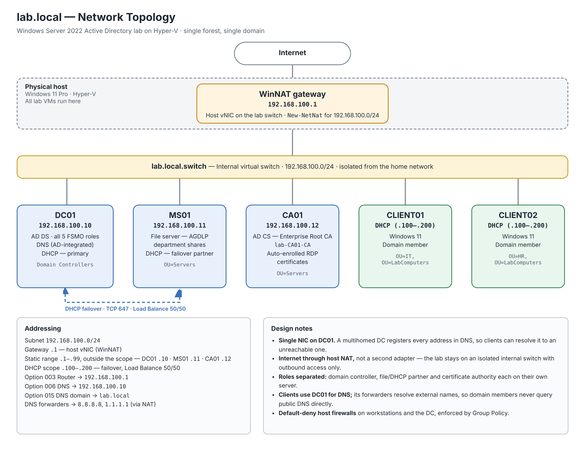

# Active Directory Home Lab

A Windows Server domain built from scratch in Hyper-V to practice and document core system administration work: Active Directory, DNS, DHCP, Group Policy, file services, PowerShell automation, and security hardening.

Every configuration step in this lab was performed and documented in PowerShell or Group Policy rather than through one-off GUI wizards, so the build is repeatable and the reasoning behind each step is recorded. Security controls are mapped to recognized frameworks (CIS Controls, NIST CSF, SOC 2) so the work reads as production practice, not just "it works."

---

## Environment

| Role | Hostname | Address | OU |
|---|---|---|---|
| Domain controller | DC01 | 192.168.100.10 (static) | Domain Controllers |
| Member server | MS01 | 192.168.100.11 (static) | Servers |
| Enterprise Root CA | CA01 | 192.168.100.12 (static) | Servers |
| Windows 11 client | CLIENT01 | DHCP assigned | LabComputers\IT |
| Windows 11 client | CLIENT02 | DHCP assigned | LabComputers\HR |

- **Hypervisor:** Hyper-V on Windows 11 Pro
- **Virtual switch:** Internal (`lab.local.switch`), isolated from the physical home network
- **Domain:** lab.local
- **Subnet:** 192.168.100.0/24
- **DHCP scope:** 192.168.100.100 – 192.168.100.200
- **Static range:** 192.168.100.1 – .99 reserved outside the scope
- **Internet:** host-based NAT via gateway 192.168.100.1 (the lab reaches the internet without multihoming the DC)



---

## What Is Built

**Active Directory Domain Services**
Forest and domain promoted on DC01. Integrated DNS installed automatically with the role. All FSMO roles held by DC01.

**DNS**
Authoritative for lab.local. Forwarders (`8.8.8.8`, `1.1.1.1`) resolve external names now that the lab has an internet route via NAT — clients resolve both internal and external names through DC01 with no per-client configuration.

**DHCP with failover**
Role installed and authorized in Active Directory. Scope configured with option 006 (DNS server) and option 015 (DNS domain name), so clients receive the correct DNS server automatically and can join the domain without per-machine configuration. Dynamic DNS registration runs under a dedicated least-privilege service account (`svc-dhcpdns`), remediating the Event 1056 finding. A **DHCP failover relationship** (Load Balance, 50/50) between DC01 and MS01 makes addressing highly available — the loss of either server does not stop leases. Configuration exported to XML as a backup.

**Member server (MS01)**
A domain-joined member server in a dedicated `Servers` OU, hosting the File Server role and acting as the DHCP failover partner. Keeping file data and the failover partner off the domain controller follows the normal production separation of roles.

**Organizational unit structure**
Users and computers are organized in separate OU branches, each subdivided by department:

```
lab.local
├── OU=LabUsers
│   ├── OU=IT, OU=HR, OU=Finance, OU=Operations
├── OU=LabComputers
│   ├── OU=IT, OU=HR, OU=Finance, OU=Operations
├── OU=Groups
├── OU=Servers
├── OU=ServiceAccounts
└── OU=Disabled Users
```

Objects are placed in OUs rather than the default `CN=Users` and `CN=Computers` containers, because Group Policy Objects cannot be linked to a container. Users and computers are separated because every GPO contains a Computer Configuration and a User Configuration section, applied according to where each object type sits — user settings follow the person to whatever machine they log into, while computer settings stay with the machine regardless of who uses it.

**Domain-joined clients**
Two Windows 11 clients joined to lab.local, receiving addressing and DNS automatically from DHCP, and placed in separate department OUs so that Group Policy scoping can be demonstrated and verified across different targets.

**Bulk user provisioning**
`New-LabUsers.ps1` reads a CSV, generates usernames from first initial plus last name, checks for existing accounts before creating, places each user in the OU matching their department, forces a password change at first logon, and adds each account to its department security group. The script is idempotent — re-running it skips existing accounts rather than erroring or creating duplicates. Verified end to end across 25 users (20 created, 5 pre-existing skipped) by logging into a client with a provisioned account and confirming the forced password change.

**Security groups and group-based access**
Global security groups per department (`IT-Users`, `HR-Users`, `Finance-Users`, `Operations-Users`) plus a cross-cutting `IT-RemoteAccess` group. Group membership drives access rather than per-user assignment, so entitlements are managed by adding or removing a single group member — the least-privilege / role-based model.

**File services — group-driven shares (AGDLP)**
Department file shares on MS01 with access granted entirely through group membership using the **AGDLP** model (Account → Global → Domain Local → Permission). Each share is permissioned to a domain-local `SH-<Dept>-Modify` group, with the department's global group nested inside it; share and NTFS permissions are set explicitly and `Everyone` removed. Validated with a live positive/negative test — an IT user reads and writes `\\MS01\IT` but is denied `\\MS01\HR`.

**Pre-staged computer objects**
`New-LabComputers.ps1` pre-stages department computer accounts in the matching computer OUs (department prefixes kept under the 15-character NetBIOS limit), so Group Policy targeting and OU structure can be demonstrated at realistic scale without building a VM per object. Real vs. placeholder objects are distinguishable by their populated `DNSHostName`.

**Group Policy**
- **IT - Local Remote Access** (linked to `OU=IT,OU=LabComputers`) — pushes `IT-RemoteAccess` into the local Remote Desktop Users group via a Local Users and Groups preference, and enables RDP. Remote-access rights delivered by group membership without touching each machine.
- **Workstation Firewall Baseline** (linked to `OU=LabComputers`) — Windows Defender Firewall on for all profiles, default-deny inbound with allow-by-exception, RDP scoped to the management source, High encryption with NLA enforced, idle/disconnected session limits, and firewall logging enabled.
- **Domain Password Policy** (domain-root, Link Order 1) — password length/complexity, account lockout, and the deliberate NIST 800-63B choice to disable forced expiration; includes the explanation of why a password policy is domain-wide and PSOs are the OU-scoped alternative.
- **Department Logon Banners** (IT → `OU=IT`, HR → `OU=HR`) — a legal logon banner scoped per department, demonstrating OU-targeted GPO precedence and verified with `gpresult` on each client.
- **DC Firewall Baseline** (linked to `OU=Domain Controllers`) — a separate default-deny inbound baseline for the domain controller with a role-aware allow-list (AD DS, DNS, DHCP, failover, NTP, scoped RDP), authored in PowerShell against the GPO policy store.

**Automated offboarding and membership audit**
`Disable-LabUser.ps1` performs a scripted leaver process — disable the account, strip group memberships, move to a `Disabled Users` OU, and append an audit log — with `-WhatIf` support. `Test-LabGroupMembership.ps1` audits whether each user is in their correct department group and reports drift, pairing detection with the provisioning/offboarding remediation.

**Internal PKI (AD Certificate Services)**
A dedicated Enterprise Root CA on CA01 issues trusted certificates across the domain. A custom `RDPAuthentication` template (Server Authentication) auto-enrolls to every machine, and a GPO points RDP at it — so RDP now presents a **CA-issued certificate trusted automatically via the AD-published root**, eliminating the self-signed-certificate warning. Validated by connecting over RDP with no warning and confirming the presented cert's issuer is `lab-CA01-CA`. Foundation for LDAPS, cert-based auth, and 802.1X.

**Internet access via NAT**
Host-based NAT gives the lab subnet internet access (Windows Update, external DNS resolution, and the cloud-identity phase) **without multihoming the domain controller** — every VM stays single-homed, and the Hyper-V host NATs the lab's traffic out through its own uplink. This reactivates the DC's DNS forwarders, which had no route until now.

**RDP connectivity remediation (troubleshooting case study)**
A persistent one-way reachability failure — DC01 could not reach CLIENT01 on ICMP or TCP 3389 despite correct allow rules — was resolved by systematic, layer-by-layer elimination (client firewall → IP → virtual switch → L2/ARP → DC adapter/stack), then a `pktmon` capture that localized the drop to the Windows Filtering Platform, and finally a `wfpdiag` state dump that **named the exact filter and its provider**: a "Shielded Main Rule" installed by the built-in firewall in shields-up mode, overriding the allow rules. Fixed at the GPO (not the client), then verified with a positive test (in-scope source succeeds) and a negative test (out-of-scope source correctly refused). Full write-up: [RDP connectivity remediation & firewall hardening](docs/RDP_Firewall_Remediation.md).

---

## Security & Compliance

Firewall and access-control decisions in this lab are deliberately mapped to recognized security frameworks, so each configuration is a named control rather than an ad-hoc setting:

- **Deny-by-default inbound, allow by exception** — CIS Control 4/13 · NIST CSF PR.PS · SOC 2 CC6.6
- **Remote access scoped to a management source** — CIS 12 · NIST CSF PR.AA · SOC 2 CC6.1
- **Least-privilege, group-based access (AGDLP)** — CIS 6 · SOC 2 CC6.1–6.3 · NIST 800-53 AC-2/AC-6
- **NLA + High encryption for remote sessions** — CIS 3/6 · SOC 2 CC6.7
- **Timely, auditable deprovisioning on separation** — SOC 2 CC6.1–6.3 · NIST 800-53 AC-2 · CIS 6
- **Service availability (DHCP failover)** — NIST CSF PR.PT/RC · SOC 2 A1
- **Trusted host identity / PKI (internal CA, CA-issued RDP certs)** — NIST 800-53 SC-12/SC-17 · NIST CSF PR.AC · SOC 2 CC6.7
- **Firewall logging (detection/audit trail)** — CIS 8 · NIST CSF DE.CM · SOC 2 CC7.2
- **GPO-enforced baseline (single source of truth)** — CIS 4 · SOC 2 CC8.1

A full control → implementation → verification crosswalk (including secondary mappings to NIST 800-171, PCI DSS, and HIPAA) is in the [RDP remediation write-up](docs/RDP_Firewall_Remediation.md). These are *technical controls demonstrated*, not a compliance certification.

---

## Documentation

| Document | Contents |
|---|---|
| [Domain controller and Active Directory](docs/DC01_Powershell.md) | OU structure, security groups, bulk provisioning, computer pre-staging, and domain joins |
| [DHCP installation and configuration](docs/DHCP_Powershell.md) | DHCP role, scope, options, forwarders, service-account remediation, backup, and failover |
| [File services (AGDLP shares)](docs/FileService.md) | Group-driven department shares on the member server, the AGDLP model, share + NTFS permissions, and live access testing |
| [Group Policy](docs/GroupPolicy.md) | Remote-access, firewall-baseline, password-policy, and department-banner GPOs, with scoping and verification |
| [DC firewall baseline](docs/DC_Firewall_Baseline.md) | Default-deny inbound firewall for the domain controller, role-aware allow-list (AD DS/DNS/DHCP), the NLA profile troubleshooting case, and verification |
| [Internal PKI (AD CS)](docs/AD_CS_PKI.md) | Enterprise Root CA, the RDP certificate template, auto-enrollment, the self-signed-warning fix, and the full troubleshooting chain |
| [Internet access via NAT](docs/NAT_Internet.md) | Host-based NAT giving the lab internet without multihoming the DC, DC default route, DNS forwarders, and troubleshooting |
| [User offboarding](docs/Offboarding.md) | Scripted leaver process — disable, strip groups, move to Disabled Users OU, and log — with compliance mapping |
| [RDP remediation & firewall hardening](docs/RDP_Firewall_Remediation.md) | Diagnostic methodology, root cause, GPO remediation, verification, and compliance crosswalk |
| [Troubleshooting notes](docs/Troubleshooting_Notes.md) | Consolidated, cross-cutting lessons from the whole build |
| [Lab rebuild runbook](docs/Lab_Rebuild.md) | Ordered, condensed steps to rebuild the entire lab from nothing |

Each document records the commands actually used, the reasoning behind them, and a troubleshooting section covering problems encountered during the build and how they were diagnosed.

---

## Skills Demonstrated

- Active Directory Domain Services installation, forest promotion, and OU design
- Member server deployment, domain join, and role separation
- Domain join and client-side configuration verification
- DNS zone hosting, record registration, and conditional forwarding
- DHCP scope configuration, AD authorization, scope options, service-account delegation, and lease verification
- DHCP failover (Load Balance) for high availability of addressing
- File services and the AGDLP resource-access model — share and NTFS permissions, least privilege
- Group Policy design, scoping, and verification (user vs. computer configuration, OU targeting, link order, `gpresult`/`gpupdate`)
- Windows Defender Firewall management via Group Policy — default-deny inbound, rule scoping, profile differentiation, and logging — on both workstations and a domain controller
- Host-based firewall baselining authored in PowerShell against the GPO policy store
- Network-profile (NLA) troubleshooting — diagnosing profile-scoped rules on a misclassified NIC
- Internal PKI with AD Certificate Services — Enterprise Root CA, certificate templates, auto-enrollment, and RDP certificate binding
- Hyper-V NAT networking — providing internet to an isolated lab without multihoming the DC, host-to-guest gateway and routing troubleshooting
- Remote access hardening — RDP with NLA, connection encryption, session limits, and source scoping
- Network troubleshooting to packet level — layered elimination, `pktmon` capture analysis, and WFP (`wfpdiag`) filter identification
- Identity lifecycle automation — bulk provisioning, offboarding, and membership-drift auditing
- Security control mapping to CIS Controls, NIST CSF, and SOC 2
- PowerShell scripting: CSV input, loops, conditional logic, error handling, idempotent operations, splatting
- Hyper-V virtual machine, virtual switch, and checkpoint management
- Static and dynamic IP addressing, subnetting, and client-side network troubleshooting
- Documenting infrastructure work in a form another administrator could follow

---

## Planned Extensions

The on-premises core is complete. With internet access now in place, the next phase extends the lab outward:

- **Linux domain integration** — joining the existing Ubuntu and RHEL VMs to the domain (`realm`/SSSD) with AD-group-driven `sudo`
- **Hybrid identity** — Microsoft 365 with Entra Connect (directory sync) and Intune (device management)
- **Google Workspace** — AD → Workspace directory sync (GCDS) and a ChromeOS Flex endpoint
- **Internal PKI depth** — LDAPS using the issued DC certificates, and a two-tier CA (offline root + issuing subordinate)

---

## Notes on Scope

This is a lab environment and some configurations are deliberately simplified.

The domain controller was initially given a second network adapter to provide internet access. This was removed after recognizing that a multihomed domain controller registers multiple addresses in DNS, which can cause clients to attempt connections on an unreachable address. The lab now runs on a single isolated adapter and reaches the internet through **host-based NAT** (gateway 192.168.100.1) instead, so the DC stays single-homed. The DNS forwarders now resolve external names through that route — see the [NAT write-up](docs/NAT_Internet.md).

The provisioning script uses a hardcoded default password rather than a credential store. RDP host identity is now secured by a CA-issued certificate from the internal Enterprise Root CA (the former self-signed certificate is replaced) — see the [AD CS write-up](docs/AD_CS_PKI.md). The domain controller's firewall logging, originally set locally as an interim measure, is now governed by the dedicated DC Firewall Baseline GPO. Because the lab network is isolated (no routable gateway), the DC's NIC classifies as a Public/Unidentified network, so the DC firewall rules are scoped to all profiles rather than Domain-only — on a routed production network they would be Domain-scoped. The single online Root CA is a lab simplification; production uses a two-tier hierarchy with an offline root. Each of these is noted in the relevant document alongside what the production approach would be.

---

## About

Built and maintained by James Andrew Kearse — U.S. Marine Corps veteran and IT support professional.
CompTIA A+ and Network+ certified. B.S. in Information Technology.
