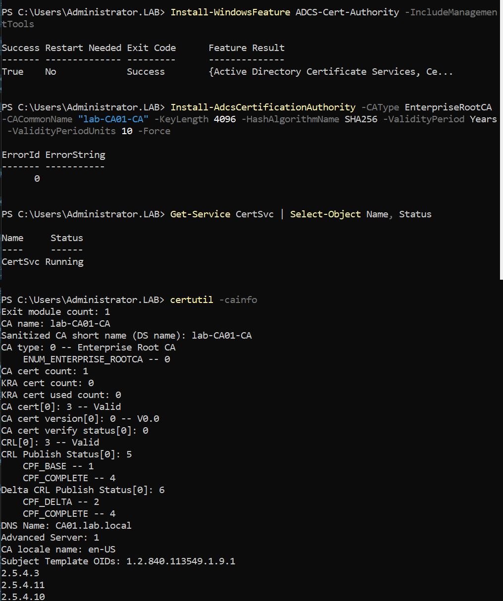
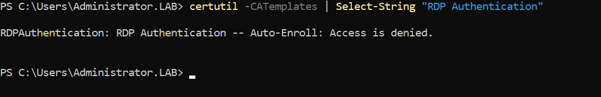
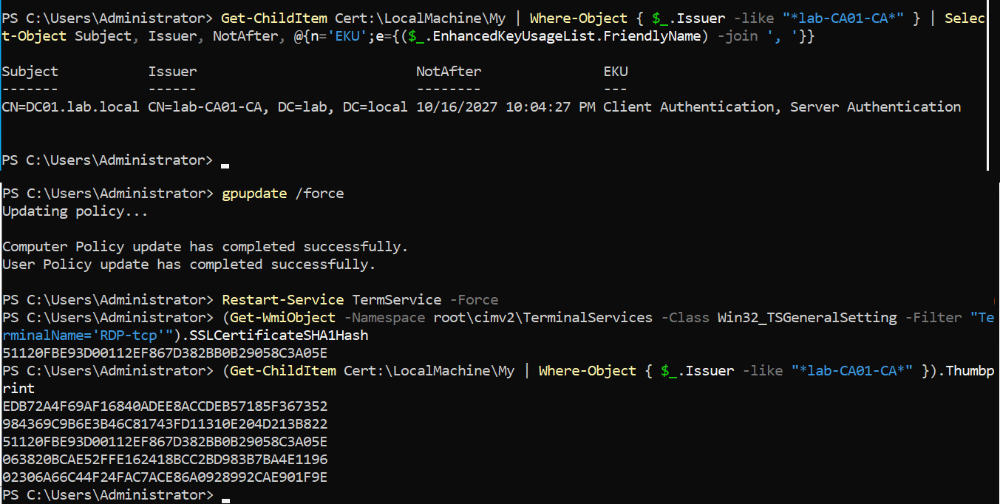
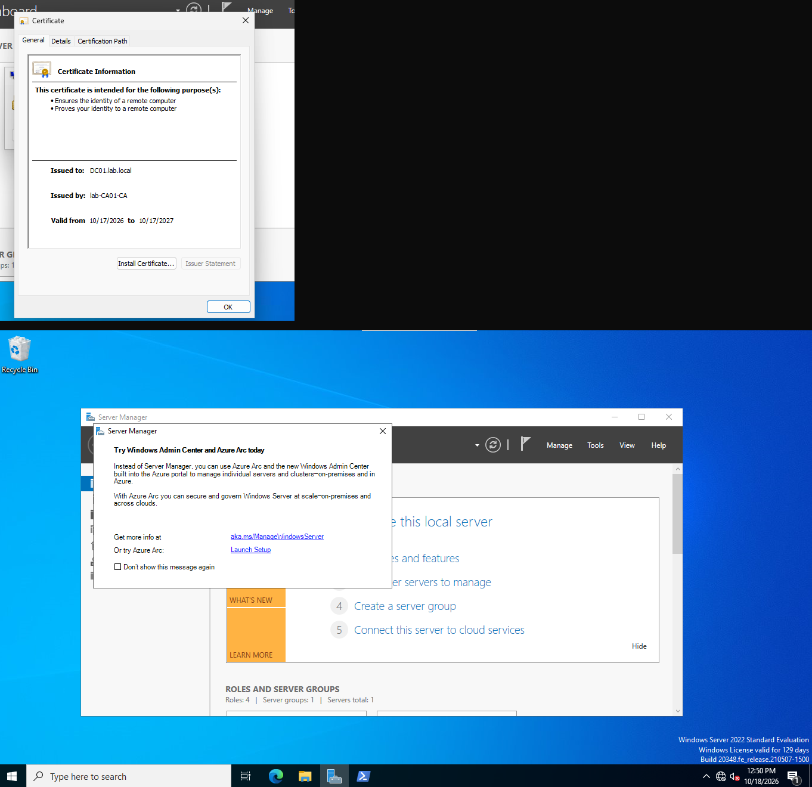

# Internal PKI — AD Certificate Services

An internal Certificate Authority that issues trusted certificates to domain
members, replacing the self-signed certificate RDP uses by default with one that
every machine in the domain trusts automatically. This removes the *"the identity
of the remote computer cannot be verified"* warning on RDP and lays the foundation
for LDAPS, certificate-based authentication, and 802.1X.

The CA runs on its own dedicated server (`CA01`), separate from the domain
controller. In production a CA is always isolated from other roles, and that
separation is modeled here rather than bolting the role onto DC01 or MS01.

Standing up an internal CA maps to identity-assurance and encryption controls
(NIST 800-53 IA-5/SC-12/SC-17, NIST CSF PR.AC/PR.DS, SOC 2 CC6.1/CC6.7).

---

## Architecture decisions

| Decision | Choice | Why |
|---|---|---|
| CA host | Dedicated VM `CA01` (192.168.100.12, `Servers` OU) | A CA shouldn't share a box with other roles; it also must never be renamed or demoted after install, so it gets a stable home of its own. |
| CA type | **Enterprise** Root CA | Integrates with AD — publishes its root to the domain Trusted Root store automatically, and supports certificate templates and auto-enrollment. A Standalone CA has none of that. |
| Tier | Single online Root CA | Production uses a two-tier model: an **offline** root and an online **issuing subordinate**, so the root's key stays off the network. A single online root is the accepted lab simplification; the two-tier model is noted below. |
| Root key / hash | 4096-bit RSA, SHA-256, 10-year validity | A root anchors all trust beneath it, so it gets a strong key and long life. SHA-1 is deprecated. |

---

## Build

### 1. CA01 server

A Generation 2 VM on the isolated lab switch, Server 2022, joined to the domain in
the `Servers` OU with a static address:

```powershell
# Host — create the VM (Gen 2, Secure Boot, lab switch)
New-VM -Name CA01 -Generation 2 -MemoryStartupBytes 2GB -NewVHDPath "C:\VMs\CA01\CA01.vhdx" -NewVHDSizeBytes 60GB -SwitchName "lab.local.switch"
Set-VMProcessor -VMName CA01 -CompatibilityForMigrationEnabled $true

# Guest — static IP, DNS at the DC, then join
New-NetIPAddress -InterfaceAlias "Ethernet" -IPAddress 192.168.100.12 -PrefixLength 24
Set-DnsClientServerAddress -InterfaceAlias "Ethernet" -ServerAddresses 192.168.100.10
Add-Computer -DomainName "lab.local" -NewName "CA01" -OUPath "OU=Servers,DC=lab,DC=local" -Credential (Get-Credential) -Restart
```

### 2. Enterprise Root CA

```powershell
Install-WindowsFeature ADCS-Cert-Authority -IncludeManagementTools
Install-AdcsCertificationAuthority -CAType EnterpriseRootCA -CACommonName "lab-CA01-CA" -KeyLength 4096 -HashAlgorithmName SHA256 -ValidityPeriod Years -ValidityPeriodUnits 10 -Force
```

Verified with `certutil -cainfo`: **CA type Enterprise Root CA**, cert valid, CRL
published, root good for 10 years. As an Enterprise CA, it immediately published
its root into AD's trust stores — no manual import on any member.



### 3. The RDP certificate template

The default RDP certificate is self-signed. To replace it, hosts need a CA-issued
cert carrying the **Server Authentication** purpose, which a template hands out.

Duplicated from the built-in **Computer** template (which already carries Client +
Server Authentication) in `certtmpl.msc`:

- Display name **`RDP Authentication`** (internal name `RDPAuthentication`)
- Compatibility raised to **Windows Server 2016 / Windows 10** (every lab OS is
  modern, so the oldest-enrolling-OS floor is set high to unlock current features)
- Validity **1 year** (leaf certs rotate; the 10-year root is the anchor)
- Subject built from AD with the **DNS name** (so the cert name matches the host)
- **Security:** `Domain Computers` **and** `Domain Controllers` granted Read +
  Enroll + Autoenroll (see the gotcha below — this detail matters)

Then published on the CA (`certsrv.msc` → Certificate Templates → New → Certificate
Template to Issue), confirmed with:

```powershell
certutil -CATemplates | Select-String "RDPAuthentication"
```



### 4. Auto-enrollment + RDP binding GPO

A single GPO (`PKI - Autoenrollment and RDP Cert`, linked at the domain root) does
two jobs:

- **Auto-enrollment** — `Computer Configuration → Windows Settings → Security
  Settings → Public Key Policies → Certificate Services Client - Auto-Enrollment`:
  **Enabled**, with renew/update ticked. Every machine now pulls its cert with no
  manual step.
- **RDP uses the cert** — `Computer Configuration → Administrative Templates →
  Windows Components → Remote Desktop Services → Remote Desktop Session Host →
  Security → Server authentication certificate template`: **Enabled**, template
  name **`RDPAuthentication`**.

```powershell
gpupdate /force
certutil -pulse        # trigger auto-enrollment immediately
```

---

## Verification

**The DC enrolled a CA-issued cert** with Server Authentication:

```powershell
Get-ChildItem Cert:\LocalMachine\My | Where-Object { $_.Issuer -like "*lab-CA01-CA*" } |
  Select-Object Subject, Issuer, NotAfter, @{n='EKU';e={($_.EnhancedKeyUsageList.FriendlyName) -join ', '}}
```
→ `CN=DC01.lab.local`, issued by `lab-CA01-CA`, EKU includes **Server Authentication**.

**RDP is bound to that cert** (not the self-signed one):

```powershell
(Get-WmiObject -Namespace root\cimv2\TerminalServices -Class Win32_TSGeneralSetting -Filter "TerminalName='RDP-tcp'").SSLCertificateSHA1Hash
```
→ matches the thumbprint of the CA-issued cert.



**The client trusts the root** (pulled automatically from AD):

```powershell
Get-ChildItem Cert:\LocalMachine\Root | Where-Object Subject -like "*lab-CA01-CA*"
```

**The payoff — RDP from CLIENT01 to DC01 connects with no certificate warning**,
presenting a cert issued by `lab-CA01-CA` instead of a self-signed one.



---

## Troubleshooting notes

This build surfaced a chain of instructive, real-world gotchas — most of them the
kind that fail *silently*.

- **Domain controllers are not members of "Domain Computers."** The template
  initially granted Autoenroll only to `Domain Computers`, so member servers and
  clients enrolled but **DC01 did not** — DCs belong to the `Domain Controllers`
  group. Since fixing the DC's RDP cert was the whole goal, this would have quietly
  defeated it. Fix: add `Domain Controllers` to the template's enroll permissions.

- **The RDP binding GPO takes the template's *internal* name.** The "Server
  authentication certificate template" setting wants `RDPAuthentication` (no
  space), not the display name "RDP Authentication". The wrong one is ignored
  silently and RDP keeps its self-signed cert.

- **Auto-enrollment happens by default; the RDP binding does not.** The DC enrolled
  a cert before any auto-enrollment GPO existed (Windows machine auto-enrollment is
  on by default once an Enterprise CA offers a permitted template). But RDP never
  switched, because the GPO that points RDP at the template **had never been
  created** — `CertTemplateName` in the registry was empty. Lesson: confirm the
  policy object actually exists, not just that a related symptom (the cert) appeared.

- **The DC firewall baseline blocked DHCP DISCOVER.** A client that had lost its
  lease fell back to an APIPA `169.254.x.x` address and couldn't reach the domain
  at all. Root cause was the predicted refinement from the
  [DC firewall baseline](DC_Firewall_Baseline.md): the `UDP 67` allow rule was
  scoped to the subnet, but a fresh client's DISCOVER originates from `0.0.0.0`,
  which the scope doesn't match — so default-deny dropped it (and the failover
  partner was offline). Fix: widen that one rule to `RemoteAddress Any`.

- **"Service running" is not "service listening."** RDP wouldn't connect even
  though `TermService` showed **Running** — but nothing was listening on 3389. The
  cause was `fDenyTSConnections = 1`: **RDP was disabled** on the DC (a local
  setting that had reverted to default). `Get-NetTCPConnection -LocalPort 3389
  -State Listen` returning empty while the service runs is the signature. Fix:
  `fDenyTSConnections = 0`, and enforce it **via GPO** on the Domain Controllers OU
  so it can't drift back — a local toggle that policy can reassert is config drift,
  not a fix.

- **A DC legitimately holds several certificates.** After auto-enrollment the DC
  had five CA-issued certs (Domain Controller, DC Authentication, Kerberos
  Authentication, Directory Email Replication, and RDPAuthentication). That's
  normal; RDP selects the one from the named template.

---

## Compliance mapping

| Control | Implementation | Framework |
|---|---|---|
| Trusted host identity / server authentication | CA-issued RDP certs replace self-signed | NIST 800-53 SC-17 · NIST CSF PR.AC |
| Key management (CA hierarchy, strong keys) | Enterprise Root CA, 4096-bit/SHA-256 | NIST 800-53 SC-12 · SOC 2 CC6.1 |
| Encryption of remote sessions with verified identity | RDP TLS using a trusted cert | SOC 2 CC6.7 · NIST CSF PR.DS |
| Automated, consistent credential issuance | Template-driven auto-enrollment | NIST 800-53 IA-5 · SOC 2 CC6.1 |
| Managed configuration (no local drift) | RDP enablement and cert binding by GPO | CIS Control 4 · SOC 2 CC8.1 |

These are *technical controls demonstrated*, not a compliance certification.

---

## Production considerations

- **Two-tier hierarchy.** Production keeps an **offline root CA** and an online
  **issuing subordinate**, so the root's private key is never exposed on a networked
  machine. The single online root here is a deliberate lab simplification.
- **Key protection.** A real CA protects its private key in an **HSM**; this lab
  uses the software KSP.
- **Revocation.** CRL/OCSP distribution points would be published to a highly
  available location (HTTP), and OCSP stapling considered, so revocation checking
  works for clients that can't reach the CA directly.
- **Shorter leaf validity + autoenrollment renewal** keeps certs fresh; 1 year is
  already reasonable, 90 days is increasingly common.
- **LDAPS and more.** With the CA in place, the DCs' Kerberos/DC-authentication
  certs also enable LDAPS, and the same template model extends to Wi-Fi/VPN
  (802.1X), code signing, and user smart-card logon.
