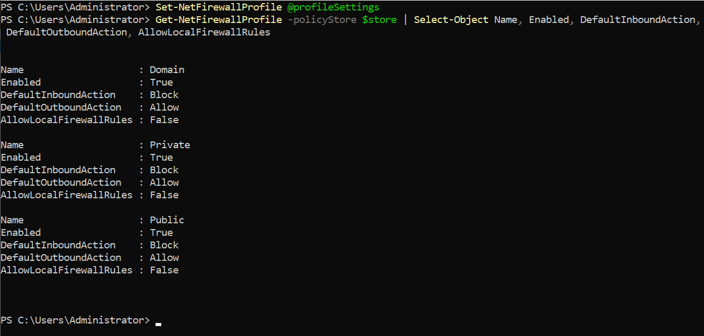
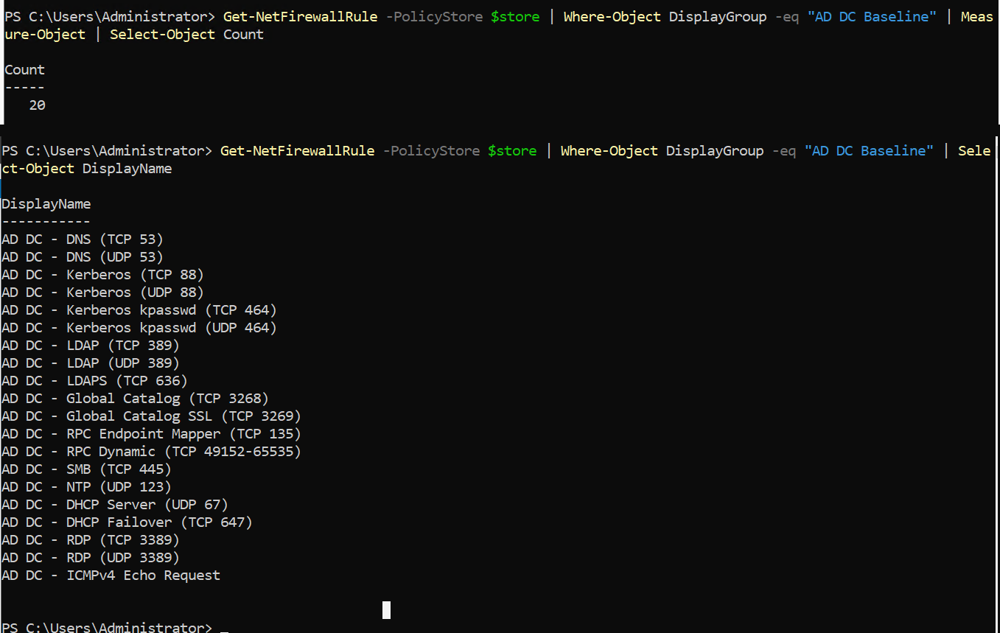
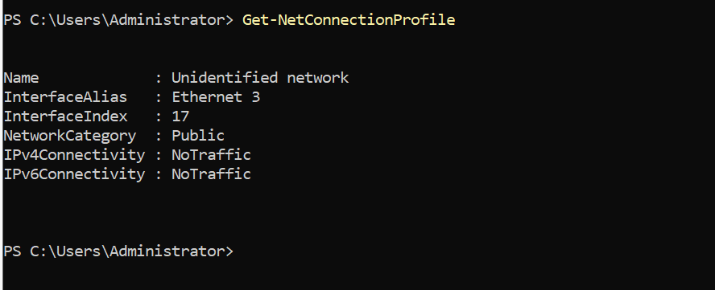
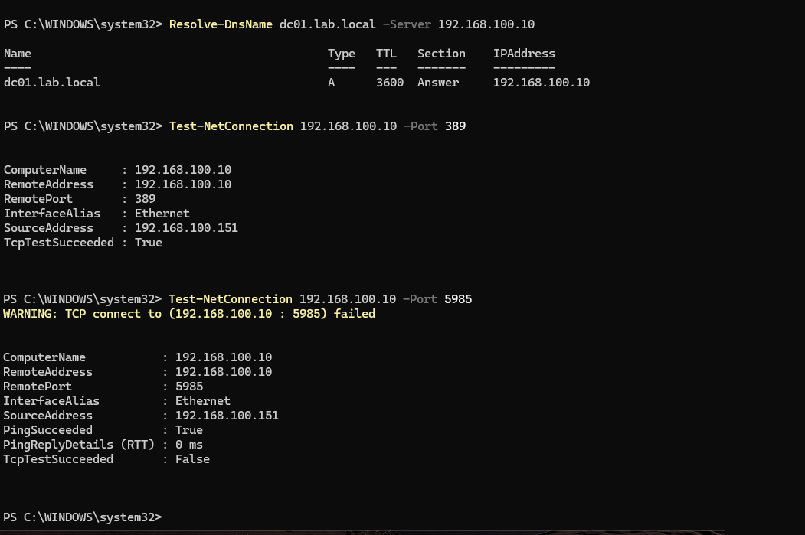

# Domain Controller Firewall Baseline

A host-based Windows Defender Firewall baseline for domain controllers, separate
from the [workstation baseline](GroupPolicy.md). A DC has a fundamentally
different inbound profile than a workstation — it *must* accept authentication,
directory, and name-resolution traffic to do its job — so applying the
workstation "deny all inbound except RDP" baseline to a DC would break the entire
domain. This baseline keeps the same **default-deny inbound** posture but pairs it
with an explicit, scoped allow-list for exactly the services this DC serves.

The whole policy is authored in **PowerShell against the GPO policy store**, which
is repeatable, reviewable, and far less error-prone than building twenty rules by
hand in the GUI.

Hardening a core infrastructure host this way maps to least-functionality and
attack-surface-reduction controls (CIS Control 4, NIST 800-53 CM-7, NIST CSF
PR.PS, SOC 2 CC6.6/CC8.1).

---

## Why this DC needs a role-aware allow-list

DC01 is not only a domain controller — it is also this environment's **DNS
server** and **primary DHCP server** (with failover to MS01). The allow-list has
to cover every role the box actually hosts, or hardening one service silently
breaks another:

| Service | Port(s) | Role it serves |
|---|---|---|
| DNS | TCP/UDP 53 | Name resolution for every domain member |
| Kerberos | TCP/UDP 88 | Authentication — the core of domain logon |
| Kerberos kpasswd | TCP/UDP 464 | Password changes |
| LDAP | TCP/UDP 389 | Directory queries (`gpupdate`, lookups) |
| LDAPS | TCP 636 | LDAP over TLS |
| Global Catalog | TCP 3268 / 3269 | Forest-wide search, UPN logon |
| RPC Endpoint Mapper | TCP 135 | Bootstraps RPC — directs clients to the dynamic port |
| RPC Dynamic | TCP 49152–65535 | Replication, Netlogon, the actual RPC calls |
| SMB | TCP 445 | SYSVOL / NETLOGON shares — Group Policy delivery |
| NTP (W32Time) | UDP 123 | DC is the domain time source; Kerberos needs clock sync |
| **DHCP Server** | UDP 67 | DC01 issues addresses |
| **DHCP Failover** | TCP 647 (→ MS01 only) | Failover sync channel to the partner |
| RDP | TCP/UDP 3389 | Remote administration (subnet-scoped) |
| ICMPv4 Echo | — | Diagnostics (ping) |

The DNS, DHCP, and failover entries are what make this specific to *this* DC —
a vanilla AD DS port list would have omitted them and knocked out addressing and
name resolution.

---

## Build

All commands run on DC01 as a domain admin. A **checkpoint was taken first**
(`Checkpoint-VM -Name DC01 -SnapshotName "Pre-DC-firewall-baseline"`) — putting a
DC behind default-deny warrants a one-click rollback path.

### 1. Create the GPO and set the profile posture

```powershell
Import-Module GroupPolicy
New-GPO -Name "DC Firewall Baseline" -Comment "Default-deny inbound baseline for Domain Controllers; allows AD DS, DNS, DHCP, DHCP failover, NTP and scoped RDP. Authored via PowerShell policy store."

$store = "lab.local\DC Firewall Baseline"

$profileSettings = @{
    PolicyStore             = $store
    Profile                 = "Domain","Private","Public"
    Enabled                 = "True"
    DefaultInboundAction    = "Block"
    DefaultOutboundAction   = "Allow"
    AllowLocalFirewallRules = "False"
    LogBlocked              = "True"
    LogAllowed              = "True"
    LogFileName             = "%systemroot%\system32\logfiles\firewall\dcfirewall.log"
    LogMaxSizeKilobytes     = 16384
}
Set-NetFirewallProfile @profileSettings
```

`AllowLocalFirewallRules = False` makes the GPO the **single source of truth** —
locally defined rules are ignored, so the firewall posture is exactly what's in
the policy and nothing else. Logging (dropped **and** allowed) moves the DC's
interim local logging into the managed baseline.



### 2. Author the scoped allow-list

A data-driven loop using **splatting** (not backtick line-continuation, which has
repeatedly dropped parameters in this build) writes all nineteen port rules;
ICMP is a single line with its own shape. Rules are scoped to the internal
subnet, and DHCP failover is scoped tighter — to MS01 only.

```powershell
$store = "lab.local\DC Firewall Baseline"
$net   = "192.168.100.0/24"
$ms01  = "192.168.100.11"

$rules = @(
  @{ n="AD DC - DNS (TCP 53)";                  proto="TCP"; port=53;            remote=$net },
  @{ n="AD DC - DNS (UDP 53)";                  proto="UDP"; port=53;            remote=$net },
  @{ n="AD DC - Kerberos (TCP 88)";             proto="TCP"; port=88;            remote=$net },
  @{ n="AD DC - Kerberos (UDP 88)";             proto="UDP"; port=88;            remote=$net },
  @{ n="AD DC - Kerberos kpasswd (TCP 464)";    proto="TCP"; port=464;           remote=$net },
  @{ n="AD DC - Kerberos kpasswd (UDP 464)";    proto="UDP"; port=464;           remote=$net },
  @{ n="AD DC - LDAP (TCP 389)";                proto="TCP"; port=389;           remote=$net },
  @{ n="AD DC - LDAP (UDP 389)";                proto="UDP"; port=389;           remote=$net },
  @{ n="AD DC - LDAPS (TCP 636)";               proto="TCP"; port=636;           remote=$net },
  @{ n="AD DC - Global Catalog (TCP 3268)";     proto="TCP"; port=3268;          remote=$net },
  @{ n="AD DC - Global Catalog SSL (TCP 3269)"; proto="TCP"; port=3269;          remote=$net },
  @{ n="AD DC - RPC Endpoint Mapper (TCP 135)"; proto="TCP"; port=135;           remote=$net },
  @{ n="AD DC - RPC Dynamic (TCP 49152-65535)"; proto="TCP"; port="49152-65535"; remote=$net },
  @{ n="AD DC - SMB (TCP 445)";                 proto="TCP"; port=445;           remote=$net },
  @{ n="AD DC - NTP (UDP 123)";                 proto="UDP"; port=123;           remote=$net },
  @{ n="AD DC - DHCP Server (UDP 67)";          proto="UDP"; port=67;            remote=$net },
  @{ n="AD DC - DHCP Failover (TCP 647)";       proto="TCP"; port=647;           remote=$ms01 },
  @{ n="AD DC - RDP (TCP 3389)";                proto="TCP"; port=3389;          remote=$net },
  @{ n="AD DC - RDP (UDP 3389)";                proto="UDP"; port=3389;          remote=$net }
)

foreach ($r in $rules) {
    $p = @{
        PolicyStore   = $store
        DisplayName   = $r.n
        Group         = "AD DC Baseline"
        Direction     = "Inbound"
        Action        = "Allow"
        Protocol      = $r.proto
        LocalPort     = $r.port
        RemoteAddress = $r.remote
        Profile       = "Domain"
        Enabled       = "True"
    }
    New-NetFirewallRule @p | Out-Null
}

New-NetFirewallRule -PolicyStore $store -DisplayName "AD DC - ICMPv4 Echo Request" -Group "AD DC Baseline" -Direction Inbound -Action Allow -Protocol ICMPv4 -IcmpType 8 -RemoteAddress $net -Profile Domain -Enabled True | Out-Null
```



### 3. Link and apply

```powershell
New-GPLink -Name "DC Firewall Baseline" -Target "OU=Domain Controllers,DC=lab,DC=local" -LinkEnabled Yes
gpupdate /force
```

Linking last means default-deny and the allow-list land together in one refresh —
there is never a window where the DC is locked down without its service rules. The
GPO targets the built-in **Domain Controllers** OU, which is a separate branch from
the `LabComputers` OU the workstation baseline is linked to, so the two baselines
never collide.

---

## Troubleshooting case study — the NIC profile trap

After linking, **every inbound connection to the DC timed out** — DNS, LDAP, ping,
all of it — even though the client was healthy with a valid lease inside the
allowed subnet.

**Diagnosis.** `Get-NetConnectionProfile` on the DC showed the cause:

```
Name             : Unidentified network
NetworkCategory  : Public
IPv4Connectivity : NoTraffic
```

The DC's NIC was classified **Public**, not `DomainAuthenticated`. Every allow
rule had been scoped to the **Domain** firewall profile — and *profile-scoped rules
only fire on the profile the NIC is actually assigned to.* On a Public-classified
NIC, none of the twenty rules applied, so the Public profile's default-block ate
everything.



**Root cause.** Network Location Awareness (NLA) assigns the Domain category only
after it confirms it can reach a domain controller. On an isolated lab with no
routable gateway, NLA can't complete that check at boot and falls back to
"Unidentified" → Public. The NIC had *already* been Public before the firewall was
applied — it simply didn't matter until rules were scoped to Domain-only.

**Fix.** Broaden the allow-list to all profiles so the DC serves its ports
regardless of NLA's classification:

```powershell
Get-NetFirewallRule -PolicyStore $store | Where-Object DisplayGroup -eq "AD DC Baseline" | Set-NetFirewallRule -Profile Any
gpupdate /force
```

After this, DNS resolved and all service ports came up immediately. The lesson is
the generally useful one: **a host-based firewall is only as correct as the
profile its rules are scoped to — always confirm `Get-NetConnectionProfile`
matches the profile your rules target.** In production, a DC on a routed network
reports `DomainAuthenticated` reliably and the tighter Domain-profile scoping is
correct; an isolated DC does not, so `Any` is the robust choice here. Same rules,
same default-deny posture — only the profile scope changes.

A second, benign symptom appeared alongside it: DHCP failover briefly showed
`CommunicationInterrupted`. That traced to MS01 having been offline during the
test, not the firewall — it returned to `Normal` on its own once MS01 was up and
the partners re-handshaked over TCP 647.

### Firewall drop vs. no listener — the 647 directionality check

Testing the 647 channel in both directions surfaced an instructive subtlety:
`MS01 → DC01:647` failed even while failover showed `Normal`. The rule was
confirmed correct (`RemoteAddress 192.168.100.11`), and
`Get-NetTCPConnection -LocalPort 647` showed **DC01 was not listening** on 647 —
even after a DHCP service restart. The failure was therefore a TCP *refusal* (no
listener), not a firewall *drop* (which fails silently and times out). In this
failover pair DC01 is the connecting partner and MS01 the listener, so the single
live session is `DC01 → MS01` and DC01 never accepts inbound 647. The inbound rule
is retained as resilience should the roles ever differ, but it is correct and the
firewall was never the cause. The general lesson: **a fast connection refusal means
no listener; a silent timeout means a firewall drop** — `Get-NetTCPConnection`
distinguishes the two definitively.

---

## Verification (positive + negative)

The same methodology as the [RDP remediation](RDP_Firewall_Remediation.md): prove
allowed traffic flows **and** prove blocked traffic is refused.

From **CLIENT01**:

```powershell
Resolve-DnsName dc01.lab.local -Server 192.168.100.10   # A record returned
Test-NetConnection 192.168.100.10 -Port 389             # LDAP  -> True
Test-NetConnection 192.168.100.10 -Port 5985            # WinRM -> False (PingSucceeded True)
gpupdate /force                                         # policy pull over SMB+LDAP
Get-ChildItem \\MS01\IT                                 # full auth chain to the member share
```



Confirmed results:

- **DNS, LDAP (389), and Kerberos all reachable** — the DC still serves name
  resolution, directory, and authentication.
- **WinRM (5985) refused, but ping succeeds** — one result proving two things: the
  default-deny is genuinely enforced (there is no rule for 5985 on any profile),
  and the scoped ICMP echo rule works. WinRM is open by default on Server 2022;
  with local rules disabled and no GPO rule for it, it is now correctly blocked.
- **`gpupdate` and `\\MS01\IT` both succeed** — the end-to-end domain (logon token,
  SYSVOL, the AGDLP share on MS01) works behind the firewall.

From the DHCP servers:

```powershell
Get-DhcpServerv4Failover | Select-Object Name, State, Mode   # State : Normal (both DC01 and MS01)
```

`Normal` from both partners confirms the failover channel is healthy through the
baseline. The inbound 647 rule permits MS01 (`RemoteAddress 192.168.100.11`); the
live session is DC01-initiated — in this pair DC01 is the connecting partner and
MS01 the listener (see the 647 diagnosis below).

---

## Compliance mapping

| Control | Implementation | Framework |
|---|---|---|
| Host firewall, default-deny inbound on critical infrastructure | Block inbound, allow by exception | CIS Control 4 · NIST CSF PR.PS · SOC 2 CC6.6 |
| Least functionality / attack-surface reduction | Only the DC's actual service ports opened | NIST 800-53 CM-7 · CIS 4 |
| Role-appropriate baseline separation | DC baseline distinct from workstation baseline | CIS 4 · SOC 2 CC8.1 |
| Scoped remote administration | RDP limited to the internal subnet | CIS 12 · SOC 2 CC6.1 |
| Managed single source of truth | `AllowLocalFirewallRules = False`, GPO-authored | CIS 4 · SOC 2 CC8.1 |
| Firewall logging (detection / audit trail) | Dropped + allowed logged to a dedicated file | CIS 8 · NIST CSF DE.CM · SOC 2 CC7.2 |

These are *technical controls demonstrated*, not a compliance certification.

---

## Production considerations

- **Profile scoping.** On a routed production network the DC NIC reports
  `DomainAuthenticated`, so rules would be scoped to the **Domain** profile; the
  `Any` scope here is a deliberate accommodation for an isolated lab (see the case
  study above).
- **Narrow the RPC dynamic range.** `49152–65535` is the full ephemeral range.
  Production hardening pins AD replication to a fixed port
  (`Restrict-ReplicationPort` registry value) and opens only that, shrinking the
  exposed range dramatically.
- **RDP to a jump host.** Remote administration would be scoped to a dedicated
  management/bastion host rather than the whole subnet.
- **DHCP DISCOVER scoping.** The UDP 67 rule is subnet-scoped, which permits lease
  *renewals* (unicast from already-leased clients). A brand-new client's initial
  DISCOVER originates from `0.0.0.0` and a strict subnet scope would not match it;
  a production baseline allows UDP 67 from `Any` (or relies on a DHCP relay/helper
  that re-sources the request). Noted as a refinement — existing lab clients renew
  normally.
- **Baseline validation before enforcement.** In a larger environment the ruleset
  would be staged with local-rule merge *on* and validated against real traffic
  (and the firewall log) before merge is disabled and the GPO becomes authoritative.
