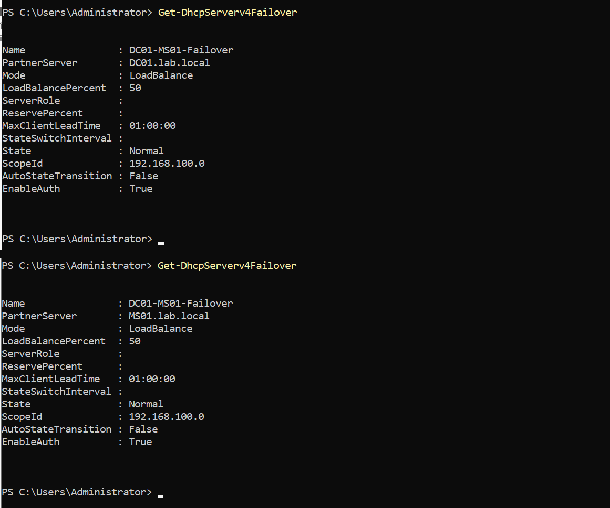
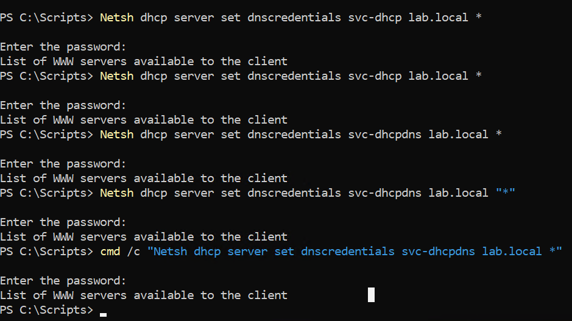
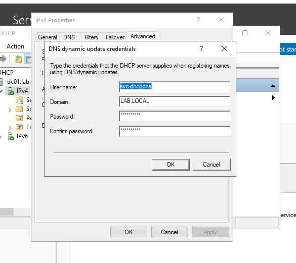
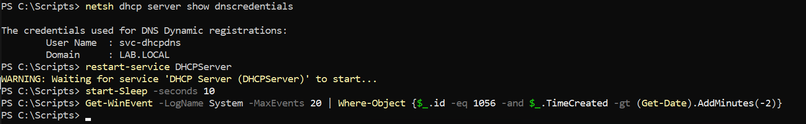

## DHCP Installation and Configuration

*To install DHCP onto the server via PowerShell I used the command below.*
```powershell
  Install-WindowsFeature DHCP -IncludeManagementTools
```

*Next I authorized the DHCP server in Active Directory. A DHCP server will not lease addresses on a domain network until it has been authorized, which prevents rogue DHCP servers from serving clients.*
```powershell
  Add-DhcpServerInDC -DnsName "DC01.lab.local" -IPAddress 192.168.100.10
```

*Next, add a DHCP range. Addresses .1 through .99 are left outside the scope so that statically assigned machines never collide with the pool.*
```powershell
  Add-DhcpServerv4Scope -Name "LabScope" -StartRange 192.168.100.100 -EndRange 192.168.100.200 -SubnetMask 255.255.255.0 -State Active
```

*Set the DNS options so clients automatically learn to use DC01 for DNS. This is what allows a client to join the domain without any per-machine configuration.*
```powershell
  Set-DhcpServerv4OptionValue -ScopeId 192.168.100.0 -DnsServer 192.168.100.10 -DnsDomain "lab.local"
```

*Clear post-install flags and restart the service.*
```powershell
  Set-ItemProperty -Path "HKLM:\SOFTWARE\Microsoft\ServerManager\Roles\12" -Name ConfigurationState -Value 2
  Restart-Service DHCPServer
```

*Verify the scope is active and the server is authorized.*
```powershell
  Get-DhcpServerv4Scope
  Get-DhcpServerInDC
```

*Remove the static IP address and enable DHCP on the client computers.*
```powershell
  Remove-NetIPAddress -InterfaceAlias "Ethernet" -AddressFamily IPv4 -Confirm:$false
  Set-NetIPInterface -InterfaceAlias "Ethernet" -Dhcp Enabled
  Set-DnsClientServerAddress -InterfaceAlias "Ethernet" -ResetServerAddresses
  ipconfig /renew
```

*Verify from the client that it received a lease with the correct DNS server assigned.*
```powershell
  ipconfig /all
```

*Verify from the server that the lease was issued, showing hostname, MAC address, assigned IP, and expiry.*
```powershell
  Get-DhcpServerv4Lease -ScopeId 192.168.100.0
```

*Create DNS forwarding functionality so the domain controller can resolve external names on behalf of clients. Domain members continue to point at the DC for DNS; the DC forwards anything it is not authoritative for.*
```powershell
  Add-DnsServerForwarder -IPAddress 8.8.8.8, 1.1.1.1
  Get-DnsServerForwarder
```

*Note: these forwarders now resolve external names — the lab reaches the internet through host-based NAT (gateway 192.168.100.1), so queries the DC is not authoritative for are forwarded upstream successfully. See the [NAT write-up](NAT_Internet.md). Internal resolution for lab.local is authoritative on the DC regardless.*

*Create a DHCP backup.*
```powershell
  Export-DhcpServer -File "C:\Backup\dhcp-config.xml" -Leases -Force
```

*Verify.*
```powershell
  Get-ChildItem C:\Backup
```
---

## DHCP Failover

A single DHCP server is a single point of failure — if it goes down, leases stop
renewing and new clients get no address. DHCP failover makes a second server
(`MS01`) a live partner to the primary (`DC01`) for the same scope, so address
assignment survives the loss of either one. This is an **availability** control
(NIST CSF PR.PT/RC, SOC 2 A1), and it's the standard way DHCP is deployed in any
environment that can't tolerate an addressing outage.

### Topology

| Role | Server | Address |
|---|---|---|
| Primary | DC01 | 192.168.100.10 |
| Partner | MS01 | 192.168.100.11 |

Both servers share one failover relationship covering the `192.168.100.0`
scope, running in **Load Balance** mode split 50/50.

### 1. DHCP role on the partner (on MS01)

```powershell
Install-WindowsFeature DHCP -IncludeManagementTools
Add-DhcpServerSecurityGroup
Restart-Service DHCPServer
```

The partner needs the DHCP role installed, but **not** a manually created scope —
the scope is replicated from the primary when the failover relationship is built.
Creating it by hand on both servers would be the wrong approach and would conflict.

### 2. Authorize the partner in Active Directory (on MS01, as a domain admin)

```powershell
Add-DhcpServerInDC -DnsName MS01.lab.local -IPAddress 192.168.100.11
```

A DHCP server will not hand out addresses until it is **authorized in AD** — this
is the directory check that stops rogue DHCP servers. See the troubleshooting note
below: this step must run in a domain security context, not as the local machine
administrator.

### 3. Create the failover relationship (on DC01)

```powershell
Add-DhcpServerv4Failover -Name "DC01-MS01-Failover" -PartnerServer MS01.lab.local -ScopeId 192.168.100.0 -LoadBalancePercent 50 -SharedSecret "<shared-secret>" -Force
```

This one command, run only on the primary, replicates the scope to the partner
and establishes the relationship. The key parameters:

- **`-PartnerServer`** — the second server that will share the scope.
- **`-ScopeId`** — the scope being made highly available (the scope *network
  address*, `192.168.100.0`, not an individual host).
- **`-LoadBalancePercent 50`** — the primary serves 50% of requests, the partner
  the other 50%.
- **`-SharedSecret`** — authenticates replication traffic between the two servers
  so failover messages can't be spoofed.

### Load Balance vs. Hot Standby

Failover runs in one of two modes — worth knowing both by name:

| Mode | Behaviour | Fits |
|---|---|---|
| **Load Balance** (used here) | Both servers active, splitting requests by percentage (default 50/50) | A single site with two peer servers |
| **Hot Standby** | One server active; the other holds a reserve of addresses and takes over only on failure | A central/branch model where the standby sits at another site |

Both modes rely on the **Maximum Client Lead Time (MCLT)** — a safety window
(default ~1 hour) a partner must wait before assuming full control of a failed
server's address pool, preventing duplicate assignment during a brief outage.

### Verification (on both DC01 and MS01)

```powershell
Get-DhcpServerv4Failover
```

Run on each server, the relationship reports **`State : Normal`**, **`Mode :
LoadBalance`**, and both servers listed as partners — confirming replication is
healthy from both sides, not just the primary.



### Troubleshooting notes

- **Authorizing DHCP in AD requires a domain security context.**
  `Add-DhcpServerInDC` failed with **DHCP error 20070 — "Failed to initialize
  directory service resources"** when logged in as the local `MS01\Administrator`.
  Authorizing a DHCP server writes to the configuration partition of AD and needs
  **Enterprise Admin** rights in a domain context. The fix was to log in as
  `LAB\Administrator` and re-run it. A local account, however privileged on the
  box, has no standing in the directory.

- **Backtick line-continuation dropped the leading hyphens on parameters.**
  The first `Add-DhcpServerv4Failover` attempt, written across multiple lines with
  backticks, silently lost the `-` on `-PartnerServer`/`-ScopeId`/others, so the
  values bound *positionally* and the command failed. Running it as a **single
  line** fixed it. This is the recurring lesson of the whole build — backtick
  continuations are fragile; prefer a single line or splatting.

### Compliance mapping

| Control | Implementation | Framework |
|---|---|---|
| Availability of a core network service | Two-server failover for DHCP | NIST CSF PR.PT/RC.RP · SOC 2 A1.1–A1.2 |
| Rogue-service prevention | AD authorization required before a server leases | NIST 800-53 CM-7 · CIS Control 4 |
| Authenticated infrastructure replication | Shared secret on the failover relationship | NIST 800-53 SC-8 · SOC 2 CC6.6 |

### Production considerations

- The **shared secret** would come from a secrets store, not be typed inline, and
  would differ per relationship.
- Larger environments often prefer **Hot Standby** across two sites so a full-site
  failure is covered, and tune **MCLT** and the standby reserve percentage to the
  recovery objective.
- Failover covers the *addressing service*; **scope options** (DNS servers, domain
  name) replicate with the scope, but any server-level option set outside the
  scope must be configured on both servers.

---

### Client adapter accumulated multiple IPv4 addresses

*A client showed three IPv4 addresses on a single adapter: 192.168.100.10, .20, and .21. `New-NetIPAddress` adds an address to an interface rather than replacing the existing one, so re-running it during configuration attempts stacked all three. One of them was .10, the address belonging to the domain controller, which would have produced an IP conflict and broken name resolution for that client. Fixed by clearing all IPv4 addresses from the interface and assigning a single correct address.*
```powershell
  Get-NetIPAddress -InterfaceAlias "Ethernet" -AddressFamily IPv4

  Remove-NetIPAddress -InterfaceAlias "Ethernet" -AddressFamily IPv4 -Confirm:$false

  New-NetIPAddress -InterfaceAlias "Ethernet" -IPAddress 192.168.100.20 -PrefixLength 24
  Set-DnsClientServerAddress -InterfaceAlias "Ethernet" -ServerAddresses 192.168.100.10
```

### Multihomed domain controller removed

*DC01 was initially configured with a second network adapter to provide internet access for updates. Server Manager subsequently reported the server with two addresses: 192.168.100.10 and a 169.254.x.x APIPA address from the second adapter. Beyond the APIPA symptom, the underlying issue was that the domain controller was multihomed. A domain controller with adapters on multiple networks registers all of its addresses in DNS, and clients may then attempt to reach it on an address they cannot route to, producing intermittent authentication and Group Policy failures. The second adapter was removed in favor of a single isolated adapter, with external routing now provided through host-based NAT instead (see the [NAT write-up](NAT_Internet.md)). DNS records were re-registered and verified afterward.*
```powershell
  Get-NetAdapter
  Get-NetIPAddress -AddressFamily IPv4 | Select-Object InterfaceAlias, IPAddress, PrefixOrigin

  ipconfig /registerdns
  Restart-Service netlogon

  Resolve-DnsName dc01.lab.local
```

### Server Manager reported roles missing after a Windows Update

*Following an update and reboot, the Server Manager dashboard listed only File and Storage Services, with no AD DS, DNS, or DHCP entries. PowerShell confirmed the roles were intact and running; Server Manager had simply not refreshed its cached role inventory after the restart. No repair was needed. The takeaway is to verify against the service and role cmdlets rather than the dashboard, since those also work over remoting when no GUI is available.*
```powershell
  Get-ADDomain
  Get-Service NTDS, DNS, DHCPServer
```

### Export-DhcpServer failed with DirectoryNotFoundException

*The backup export failed because the target folder did not exist. Most PowerShell cmdlets that write files will not create parent directories, by design, so that a mistyped path does not silently produce an unexpected folder. Fixed by creating the directory first.*
```powershell
  New-Item -Path "C:\Backup" -ItemType Directory
  Export-DhcpServer -File "C:\Backup\dhcp-config.xml" -Leases -Force
```

### DHCP Event ID 1056 — dynamic DNS registration credentials

*The System log recorded a recurring warning that the DHCP service was running on a domain controller with no dedicated credentials configured for dynamic DNS registration. In that state, DHCP registers client DNS records using the domain controller's machine account, which carries far more privilege than creating a DNS record requires. Anything able to leverage the DHCP service would inherit that privilege.*

*Remediated by creating a dedicated service account with no group memberships beyond Domain Users, placed in a ServiceAccounts OU to keep service identities separate from user accounts.*

```powershell
  $pw = Read-Host -AsSecureString "Password for svc-dhcpdns"

  New-ADOrganizationalUnit -Name "ServiceAccounts" -Path "DC=lab,DC=local"

  New-ADUser -Name "svc-dhcpdns" -SamAccountName "svc-dhcpdns" -UserPrincipalName "svc-dhcpdns@lab.local" -Description "DHCP dynamic DNS registration - least privilege" -AccountPassword $pw -PasswordNeverExpires $true -Enabled $true -Path "OU=ServiceAccounts,DC=lab,DC=local"
```

*The first attempts used an incorrect account name. This was correct. Then identified the documented command for assigning the credentials, `netsh dhcp server set dnscredentials`, did not behave as expected on Windows Server 2022. Every variation of the syntax accepted the password prompt and then returned unrelated output belonging to a different netsh context, indicating the verb was not being parsed. Running it through cmd rather than PowerShell produced the same result, ruling out a quoting issue. The credentials were configured through the DHCP console instead — right-click the IPv4 node, Properties, Advanced tab, Credentials — which wrote the configuration successfully.*





*Verified by reading the credentials back, restarting the service to trigger the condition that produces the warning, and confirming no new Event 1056 was logged.*

```powershell
  netsh dhcp server show dnscredentials

  Restart-Service DHCPServer

  Get-WinEvent -LogName System -MaxEvents 20 | Where-Object {$_.Id -eq 1056 -and $_.TimeCreated -gt (Get-Date).AddMinutes(-2)}
```

*`show dnscredentials` returned the account and domain, and the filtered event query returned nothing, confirming the warning no longer fires. Note that Event 1056 is logged when the DHCP service starts rather than on each lease, so a service restart is required to test the fix rather than simply renewing a client lease.*

### Virtual machine connection dropped on restart

*Restarting the server produced a "The session was disconnected" dialog in the Virtual Machine Connection window. This is expected behavior rather than a fault: VMConnect uses an RDP-based session for enhanced session mode, and that session is torn down when the guest restarts. The VM status remained Running throughout. Reconnecting after the guest finished booting restored the session.*

---

## Scope Design Notes

*The choices behind the scope, and the alternatives a design review would ask about.*

- **Lease duration.** The default 8-day lease suits a stable network of mostly-persistent clients. Shorter leases (hours) fit high-churn networks such as guest Wi-Fi, so addresses return to the pool quickly; longer leases reduce DHCP chatter but reclaim addresses slowly. Lease length is a trade-off between pool availability and renewal traffic.
- **Reservations vs. exclusions.** A **reservation** hands a specific device the same address from inside the pool, keyed by MAC — the right tool for printers and appliances that need a stable IP but should still be DHCP-managed (options and visibility included). An **exclusion** removes addresses from the pool entirely, for devices configured statically. This lab uses the simplest form of exclusion: all static servers (`.10`–`.12`) and the gateway (`.1`) live in the `.1`–`.99` range, which is kept **outside** the scope altogether, so a static address can never collide with a lease.
- **Failover mode.** The lab uses **Load Balance (50/50)** — both servers active and sharing requests — which suits a single site. **Hot Standby** (one active, one holding a reserve) fits a central/branch model where the standby sits at another site. The legacy **80/20 split scope** across two independent servers predates the failover feature and is no longer the recommended approach, because the two servers don't share lease state.
- **Scope options over per-client config.** Options 003 (router), 006 (DNS), and 015 (DNS domain) are set once on the scope so every client self-configures for the domain — the reason a new machine can join `lab.local` with zero manual network setup.

---

## Production Considerations

*DHCP dynamic DNS registration should run under a dedicated service account rather than the domain controller machine account. The scope now hands a default gateway (option 003 → 192.168.100.1) so clients route to the internet through host-based NAT. DHCP failover between DC01 and MS01 is configured so address assignment survives the loss of a single host — see the DHCP Failover section above.*
