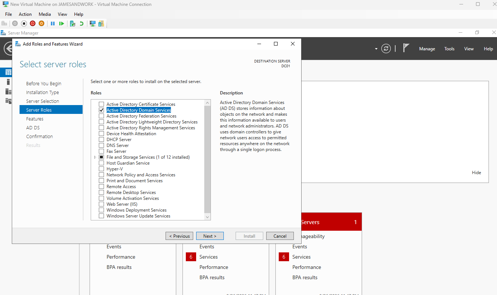
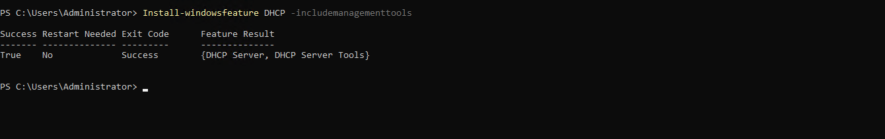

# Lab Rebuild Runbook

A condensed, ordered record of every step required to rebuild this lab from
nothing. The section documents in `docs/` explain the reasoning behind each
decision and record the problems encountered along the way; this file is the
sequence, stripped down to what needs to be run and in what order.

Written both as disaster recovery notes and as a reproducibility check — if the
lab cannot be rebuilt from its own documentation, the documentation is
incomplete.

---

## 1. Host prerequisites

Windows 11 Pro (Home does not include Hype# Lab Rebuild Runbook

A condensed, ordered record of every step required to rebuild this lab from
nothing. The section documents in `docs/` explain the reasoning behind each
decision and record the problems encountered along the way; this file is the
sequence, stripped down to what needs to be run and in what order.

Written both as disaster-recovery notes and as a reproducibility check — if the
lab cannot be rebuilt from its own documentation, the documentation is
incomplete.

**End state:** a `lab.local` forest with a domain controller (DC01), a member
server (MS01), an Enterprise Root CA (CA01) and two Windows 11 clients; DHCP with
failover; group-driven file shares; a full Group Policy suite; host-based
firewalls on workstations and the DC; internal PKI; and internet access via NAT.

| Host | Address | Role |
|---|---|---|
| DC01 | 192.168.100.10 | AD DS, DNS, DHCP (primary) |
| MS01 | 192.168.100.11 | File server, DHCP failover partner |
| CA01 | 192.168.100.12 | Enterprise Root CA |
| CLIENT01 / CLIENT02 | DHCP (.100–.200) | Windows 11 clients |
| *host vNIC* | 192.168.100.1 | NAT gateway |

---

## 1. Host prerequisites

Windows 11 Pro (Home does not include Hyper-V), at least 16 GB RAM, 150 GB free
disk, and hardware virtualization enabled in firmware.

```powershell
Get-ComputerInfo -Property "HyperV*"
Enable-WindowsOptionalFeature -Online -FeatureName Microsoft-Hyper-V -All   # reboot after
```

---

## 2. Virtual switch

An internal switch keeps the lab isolated from the physical network. VMs reach
each other and the host; routing outward is added via NAT in the next step.

```powershell
New-VMSwitch -SwitchName "lab.local.switch" -SwitchType Internal
Get-VMSwitch
```

---

## 3. Internet access via NAT

Host-based NAT gives the lab subnet internet access without multihoming the DC.
The host's adapter for the internal switch holds the gateway address, and a NAT
routes the lab's traffic out through the host's own uplink. Full detail and
troubleshooting in [Internet access via NAT](NAT_Internet.md).

```powershell
# The host's vNIC for the internal switch gets the gateway IP
New-NetIPAddress -IPAddress 192.168.100.1 -PrefixLength 24 -InterfaceAlias "vEthernet (lab.local.switch)"
New-NetNat -Name "lab-nat" -InternalIPInterfaceAddressPrefix "192.168.100.0/24"
```

Static hosts (DC01/MS01/CA01) each need a default route to `.1` (added in their
sections); DHCP clients receive it automatically via scope option 003.

---

## 4. Virtual machines

All Generation 2, Secure Boot template Microsoft Windows, attached to
`lab.local.switch`. Server and Windows 11 ISOs are the free evaluation editions.
Servers get the Desktop Experience edition for the management consoles.

```powershell
# Domain controller and clients (4 GB); member server and CA (2 GB)
New-VM -Name "DC01"     -Generation 2 -MemoryStartupBytes 4GB -NewVHDPath "C:\VMs\DC01\DC01.vhdx"         -NewVHDSizeBytes 60GB -SwitchName "lab.local.switch"
New-VM -Name "MS01"     -Generation 2 -MemoryStartupBytes 2GB -NewVHDPath "C:\VMs\MS01\MS01.vhdx"         -NewVHDSizeBytes 60GB -SwitchName "lab.local.switch"
New-VM -Name "CA01"     -Generation 2 -MemoryStartupBytes 2GB -NewVHDPath "C:\VMs\CA01\CA01.vhdx"         -NewVHDSizeBytes 60GB -SwitchName "lab.local.switch"
New-VM -Name "CLIENT01" -Generation 2 -MemoryStartupBytes 4GB -NewVHDPath "C:\VMs\CLIENT01\CLIENT01.vhdx" -NewVHDSizeBytes 60GB -SwitchName "lab.local.switch"
New-VM -Name "CLIENT02" -Generation 2 -MemoryStartupBytes 4GB -NewVHDPath "C:\VMs\CLIENT02\CLIENT02.vhdx" -NewVHDSizeBytes 60GB -SwitchName "lab.local.switch"
```

For each VM: attach the ISO, set Secure Boot, enable processor-compatibility (so
VMs survive moving between hosts without the saved-state CPU error), install
Windows. Example for one VM:

```powershell
Add-VMDvdDrive -VMName "DC01" -Path "C:\ISO\WindowsServer2022.iso"
Set-VMFirmware  -VMName "DC01" -SecureBootTemplate MicrosoftWindows
Set-VMProcessor -VMName "DC01" -CompatibilityForMigrationEnabled $true
```

---

## 5. Domain controller networking

A domain controller uses a single fixed address and points DNS at itself. The
default route to the NAT gateway lets it forward external DNS.

```powershell
New-NetIPAddress -InterfaceAlias "Ethernet" -IPAddress 192.168.100.10 -PrefixLength 24
Set-DnsClientServerAddress -InterfaceAlias "Ethernet" -ServerAddresses 127.0.0.1
New-NetRoute -InterfaceAlias "Ethernet" -DestinationPrefix "0.0.0.0/0" -NextHop "192.168.100.1"
Rename-Computer -NewName "DC01" -Restart
```

---

## 6. Promote to domain controller

Installs AD DS and creates a new forest; DNS is installed automatically.

```powershell
Install-WindowsFeature AD-Domain-Services -IncludeManagementTools
Install-ADDSForest -DomainName "lab.local"
```

Supply a DSRM password, allow the reboot, log back in as `LAB\Administrator`.



```powershell
Get-ADDomain
Get-Service NTDS, DNS
```

---

## 7. DNS forwarders

The DC is authoritative for `lab.local` and forwards everything else upstream.
With NAT in place (step 3) and the DC's default route (step 5), these resolve
external names.

```powershell
Add-DnsServerForwarder -IPAddress 8.8.8.8
Add-DnsServerForwarder -IPAddress 1.1.1.1
Resolve-DnsName microsoft.com      # confirms external resolution works
```

---

## 8. DHCP (primary, on DC01)

Install, authorize in AD, create the scope, and set the options clients need —
including the default gateway (option 003 → the NAT gateway). Addresses `.1`–`.99`
are left outside the scope for static machines. Full detail in
[DHCP](DHCP.md).

```powershell
Install-WindowsFeature DHCP -IncludeManagementTools
Add-DhcpServerInDC -DnsName "DC01.lab.local" -IPAddress 192.168.100.10

Add-DhcpServerv4Scope -Name "LabScope" -StartRange 192.168.100.100 -EndRange 192.168.100.200 -SubnetMask 255.255.255.0 -State Active
Set-DhcpServerv4OptionValue -ScopeId 192.168.100.0 -DnsServer 192.168.100.10 -DnsDomain "lab.local" -Router 192.168.100.1

Set-ItemProperty -Path "HKLM:\SOFTWARE\Microsoft\ServerManager\Roles\12" -Name ConfigurationState -Value 2
Restart-Service DHCPServer
```

Create the least-privilege dynamic-DNS service account, then set it as the DHCP
DNS credentials via the DHCP console (IPv4 → Properties → Advanced → Credentials —
the `netsh` verb misbehaves on Server 2022). This remediates Event ID 1056.

```powershell
$pw = Read-Host -AsSecureString "Password for svc-dhcpdns"
New-ADOrganizationalUnit -Name "ServiceAccounts" -Path "DC=lab,DC=local"
New-ADUser -Name "svc-dhcpdns" -SamAccountName "svc-dhcpdns" -UserPrincipalName "svc-dhcpdns@lab.local" -Description "DHCP dynamic DNS registration - least privilege" -AccountPassword $pw -PasswordNeverExpires $true -Enabled $true -Path "OU=ServiceAccounts,DC=lab,DC=local"
```

Back up the config (create the target directory first):

```powershell
New-Item -Path "C:\Backup" -ItemType Directory
Export-DhcpServer -File "C:\Backup\dhcp-config.xml" -Leases -Force
```

---

## 9. Organizational unit structure

Users and computers in separate branches (a container cannot have a GPO linked to
it), each subdivided by department, plus the OUs used by later sections.

```powershell
New-ADOrganizationalUnit -Name "LabUsers" -Path "DC=lab,DC=local"
"IT","HR","Finance","Operations" | ForEach-Object { New-ADOrganizationalUnit -Name $_ -Path "OU=LabUsers,DC=lab,DC=local" }

New-ADOrganizationalUnit -Name "LabComputers" -Path "DC=lab,DC=local"
"IT","HR","Finance","Operations" | ForEach-Object { New-ADOrganizationalUnit -Name $_ -Path "OU=LabComputers,DC=lab,DC=local" }

New-ADOrganizationalUnit -Name "Servers" -Path "DC=lab,DC=local"
New-ADOrganizationalUnit -Name "Groups"  -Path "DC=lab,DC=local"

Get-ADOrganizationalUnit -Filter * | Select-Object Name, DistinguishedName
```

(The `Disabled Users` OU is created by the offboarding workflow — see
[offboarding](Offboarding.md).)

---

## 10. Security groups

Access is by group membership. Department global groups must exist before user
provisioning (the script adds each user to their `<Department>-Users` group),
plus the cross-cutting `IT-RemoteAccess` group.

```powershell
"IT","HR","Finance","Operations" | ForEach-Object {
    New-ADGroup -Name "$_-Users" -GroupScope Global -GroupCategory Security -Path "OU=$_,OU=LabUsers,DC=lab,DC=local"
}
New-ADGroup -Name "IT-RemoteAccess" -GroupScope Global -GroupCategory Security -Path "OU=LabUsers,DC=lab,DC=local"
```

---

## 11. User provisioning

Place `New-LabUsers.ps1` and `newusers.csv` from `scripts/` into `C:\Scripts`.
Department OUs and groups must already exist.

```powershell
Set-ExecutionPolicy RemoteSigned
cd C:\Scripts
.\New-LabUsers.ps1
```

The script creates each user in the right OU, forces a first-logon password
change, and adds each to their department group. Re-run to confirm idempotency.

```powershell
.\Test-LabGroupMembership.ps1 | Where-Object MissingFromGroup
.\New-LabUsers.ps1
```

---

## 12. Client configuration and domain join

On each client: switch to DHCP and let the scope supply address, DNS, and gateway.

```powershell
Remove-NetIPAddress -InterfaceAlias "Ethernet" -AddressFamily IPv4 -Confirm:$false
Set-NetIPInterface -InterfaceAlias "Ethernet" -Dhcp Enabled
Set-DnsClientServerAddress -InterfaceAlias "Ethernet" -ResetServerAddresses
ipconfig /renew
```

Verify the DC is answering (port 389 confirms the directory service, not just the
host), then join.

```powershell
Test-NetConnection 192.168.100.10 -Port 389
Resolve-DnsName lab.local
Add-Computer -DomainName "lab.local" -NewName "CLIENT01" -Restart
```

---

## 13. Computer object placement and pre-staging

Move the joined clients into department OUs (run on DC01), then pre-stage
placeholder computer objects for realistic GPO targeting.

```powershell
Get-ADComputer CLIENT01 | Move-ADObject -TargetPath "OU=IT,OU=LabComputers,DC=lab,DC=local"
Get-ADComputer CLIENT02 | Move-ADObject -TargetPath "OU=HR,OU=LabComputers,DC=lab,DC=local"

cd C:\Scripts
.\New-LabComputers.ps1
Get-ADComputer -Filter * -Properties DNSHostName | Select-Object Name, DNSHostName
```

DC01 stays in the built-in Domain Controllers OU — do not move it.

---

## 14. Member server (MS01)

A member server off the DC for file data and the DHCP failover partner. Build the
VM (step 4), then on MS01: static IP, DNS at the DC, default route, domain join
into `Servers`.

```powershell
New-NetIPAddress -InterfaceAlias "Ethernet" -IPAddress 192.168.100.11 -PrefixLength 24
Set-DnsClientServerAddress -InterfaceAlias "Ethernet" -ServerAddresses 192.168.100.10
New-NetRoute -InterfaceAlias "Ethernet" -DestinationPrefix "0.0.0.0/0" -NextHop "192.168.100.1"
Add-Computer -DomainName "lab.local" -NewName "MS01" -OUPath "OU=Servers,DC=lab,DC=local" -Credential (Get-Credential) -Restart
```

(If the rename-on-join hits "directory service is busy", join succeeds — rename
separately afterward with `Rename-Computer -NewName MS01 -DomainCredential (Get-Credential) -Restart`.)

---

## 15. DHCP failover

Makes addressing highly available across DC01 and MS01 (Load Balance, 50/50).
Full detail in [DHCP → Failover](DHCP.md).

```powershell
# On MS01 — install + authorize (run as LAB\Administrator; authorizing needs Enterprise Admin)
Install-WindowsFeature DHCP -IncludeManagementTools
Add-DhcpServerSecurityGroup
Restart-Service DHCPServer
Add-DhcpServerInDC -DnsName MS01.lab.local -IPAddress 192.168.100.11

# On DC01 — create the relationship (one command replicates the scope to MS01)
Add-DhcpServerv4Failover -Name "DC01-MS01-Failover" -PartnerServer MS01.lab.local -ScopeId 192.168.100.0 -LoadBalancePercent 50 -SharedSecret "<shared-secret>" -Force
Get-DhcpServerv4Failover | Select-Object Name, State, Mode     # State : Normal on both
```

---

## 16. File services — group-driven shares (AGDLP)

Department shares on MS01, permissioned by group using Account → Global → Domain
Local → Permission. Full detail and the live allow/deny test in
[File services](FileService.md).

```powershell
# On MS01 — role + folders
Install-WindowsFeature FS-FileServer
New-Item -ItemType Directory -Force -Path C:\Shares\IT, C:\Shares\HR, C:\Shares\Finance, C:\Shares\Operations

# On DC01 — domain-local groups, nesting the department global groups
"IT","HR","Finance","Operations" | ForEach-Object {
    New-ADGroup -Name "SH-$_-Modify" -GroupScope DomainLocal -GroupCategory Security -Path "OU=Groups,DC=lab,DC=local"
    Add-ADGroupMember -Identity "SH-$_-Modify" -Members "$_-Users"
}

# On MS01 — shares + share/NTFS permissions scoped to each domain-local group
"IT","HR","Finance","Operations" | ForEach-Object {
    $path = "C:\Shares\$_"; $grp = "LAB\SH-$_-Modify"
    New-SmbShare -Name $_ -Path $path -ChangeAccess $grp -FullAccess "LAB\Domain Admins"
    Revoke-SmbShareAccess -Name $_ -AccountName "Everyone" -Force -ErrorAction SilentlyContinue
    icacls $path /inheritance:r | Out-Null
    icacls $path /grant "SYSTEM:(OI)(CI)F" "Administrators:(OI)(CI)F" "${grp}:(OI)(CI)M" | Out-Null
}
```

---

## 17. Group Policy

Full settings, verification, and troubleshooting in [Group Policy](GroupPolicy.md).
Create and link, in order:

1. **IT - Local Remote Access** → `OU=IT,OU=LabComputers` — adds `LAB\IT-RemoteAccess`
   to local Remote Desktop Users and enables RDP.
2. **Workstation Firewall Baseline** → `OU=LabComputers` — firewall on all profiles,
   default-deny inbound, RDP scoped to the management source, NLA + High encryption,
   session limits, logging.
3. **Domain Password Policy** → domain root, Link Order 1 — length/complexity,
   lockout, and the NIST 800-63B choice to disable forced expiration (password
   policy is domain-wide; PSOs are the OU-scoped alternative).
4. **Department Logon Banners** → `OU=IT` and `OU=HR` — per-department legal banner,
   demonstrating OU-targeted precedence.

```powershell
gpupdate /force                       # on each client
gpresult /r /scope computer
```

---

## 18. Domain Controller firewall baseline

A separate default-deny inbound baseline for the DC with a role-aware allow-list
(AD DS, DNS, DHCP, failover, NTP, scoped RDP), authored in PowerShell against the
GPO policy store. **Checkpoint DC01 first.** Full detail in
[DC firewall baseline](DC_Firewall_Baseline.md).

```powershell
New-GPO -Name "DC Firewall Baseline"
$store = "lab.local\DC Firewall Baseline"
Set-NetFirewallProfile -PolicyStore $store -Profile Domain,Private,Public -Enabled True -DefaultInboundAction Block -DefaultOutboundAction Allow -AllowLocalFirewallRules False -LogBlocked True -LogAllowed True -LogFileName "%systemroot%\system32\logfiles\firewall\dcfirewall.log"
# ...author the scoped allow-rules (full loop in the doc), then:
New-GPLink -Name "DC Firewall Baseline" -Target "OU=Domain Controllers,DC=lab,DC=local" -LinkEnabled Yes
gpupdate /force
```

> Isolated-lab note: the DC's NIC classifies as Public/Unidentified (no routable
> gateway identity), so the allow-rules are scoped to **all profiles**, not
> Domain-only. Also enable RDP by policy here (Connections → *Allow users to connect
> remotely*) so it doesn't drift to disabled, and allow DHCP (UDP 67) from **Any**
> so fresh-client DISCOVER packets (source 0.0.0.0) aren't dropped.

---

## 19. Internal PKI (AD Certificate Services)

An Enterprise Root CA on CA01 issues trusted certs; a template auto-enrolls an
RDP Server-Authentication cert to every host, and a GPO binds RDP to it — removing
the self-signed warning. Full detail and troubleshooting in [AD CS](AD_CS_PKI.md).

Build CA01 (step 4), set static `.12`/DNS/default route, join into `Servers`
(as in step 14). Then:

```powershell
# On CA01 (as LAB\Administrator) — role + Enterprise Root CA
Install-WindowsFeature ADCS-Cert-Authority -IncludeManagementTools
Install-AdcsCertificationAuthority -CAType EnterpriseRootCA -CACommonName "lab-CA01-CA" -KeyLength 4096 -HashAlgorithmName SHA256 -ValidityPeriod Years -ValidityPeriodUnits 10 -Force
```

- In `certtmpl.msc`, **duplicate the Computer template** → `RDP Authentication`
  (internal name `RDPAuthentication`), compatibility Server 2016 / Win10, and grant
  **Domain Computers *and* Domain Controllers** Read + Enroll + Autoenroll. (DCs are
  not members of Domain Computers — omit them and the DC won't enrol.)
- Publish it on the CA (`certsrv.msc` → Certificate Templates → New → Certificate
  Template to Issue).
- GPO `PKI - Autoenrollment and RDP Cert` (domain root): enable **Certificate
  Services Client – Auto-Enrollment**, and set **Server authentication certificate
  template** = `RDPAuthentication` (the internal name, no space).

```powershell
gpupdate /force; certutil -pulse      # on DC01/clients to enroll
```

---

## 20. End-to-end verification

```powershell
# Core services and directory (on DC01)
Get-ADDomain
Get-Service NTDS, DNS, DHCPServer
Get-DhcpServerv4Failover | Select-Object Name, State, Mode
Get-ADUser -Filter * | Select-Object Name, DistinguishedName
Resolve-DnsName dc01.lab.local
Resolve-DnsName microsoft.com                       # internet via NAT + forwarders

# From a client as a provisioned IT user
Get-ChildItem \\MS01\IT                              # AGDLP allow
Get-ChildItem \\MS01\HR                              # AGDLP deny (Access is denied)
mstsc /v:dc01.lab.local                              # RDP with no cert warning (CA-issued)
ping 8.8.8.8                                         # internet
```

A forced password change on first client logon confirms account, OU placement,
and password policy together.

---

## 21. Checkpoints

Checkpoint each VM in a known-good state before significant changes. Run from the
host (Hyper-V cmdlets do not exist inside a guest). Shut VMs down cleanly before
moving them between machines — a saved state cannot restore on a different CPU.

```powershell
"DC01","MS01","CA01","CLIENT01","CLIENT02" | ForEach-Object { Checkpoint-VM -Name $_ -SnapshotName "Clean build" }
```

---

## Known gaps

Recorded so a rebuild does not silently inherit them:

- The provisioning script contains a hardcoded default password.
- Administration is performed by logging into servers directly. Production practice
  is to manage the domain from a workstation with RSAT, since interactive logon to a
  DC exposes privileged credentials on a system that should have minimal exposure.
- The internal PKI is a single online Root CA. Production uses a two-tier hierarchy
  with an offline root and an online issuing subordinate.
- NAT is provided by the host (a workstation), not a firewall/router with egress
  filtering and logging.

*Resolved since earlier drafts: DHCP dynamic DNS now runs under the dedicated
`svc-dhcpdns` account (Event 1056); the RDP one-way reachability failure is fixed
([RDP remediation](RDP_Firewall_Remediation.md)); internet access is provided via
[NAT](NAT_Internet.md) (the DNS forwarders now resolve and the DHCP scope hands a
gateway); RDP host identity is secured by the internal CA ([AD CS](AD_CS_PKI.md));
and the DC firewall is governed by a dedicated baseline GPO
([DC firewall baseline](DC_Firewall_Baseline.md)).*
r-V), at least 16 GB RAM, 100 GB free
disk, and hardware virtualization enabled in firmware.

Confirm virtualization is available, then enable Hyper-V and reboot.

```powershell
Get-ComputerInfo -Property "HyperV*"

Enable-WindowsOptionalFeature -Online -FeatureName Microsoft-Hyper-V -All
```

---

## 2. Virtual switch

An internal switch keeps the lab isolated from the physical network. VMs can
reach each other and the host, but nothing routes outward.

```powershell
New-VMSwitch -SwitchName "LabSwitch" -SwitchType Internal
Get-VMSwitch
```

---

## 3. Virtual machines

One domain controller and two clients, all Generation 2, all attached to
LabSwitch. Server ISO and Windows 11 ISO are the free evaluation editions from
the Microsoft Evaluation Center.

```powershell
New-VM -Name "DC01" -Generation 2 -MemoryStartupBytes 4GB `
    -NewVHDPath "C:\VMs\DC01\DC01.vhdx" -NewVHDSizeBytes 60GB `
    -SwitchName "LabSwitch"

New-VM -Name "CLIENT01" -Generation 2 -MemoryStartupBytes 4GB `
    -NewVHDPath "C:\VMs\CLIENT01\CLIENT01.vhdx" -NewVHDSizeBytes 60GB `
    -SwitchName "LabSwitch"

New-VM -Name "CLIENT02" -Generation 2 -MemoryStartupBytes 4GB `
    -NewVHDPath "C:\VMs\CLIENT02\CLIENT02.vhdx" -NewVHDSizeBytes 60GB `
    -SwitchName "LabSwitch"
```

Attach the installation media and confirm the Secure Boot template is set to
Microsoft Windows, then install Windows on each. Choose the Desktop Experience
edition on the server.

```powershell
Add-VMDvdDrive -VMName "DC01" -Path "C:\ISO\WindowsServer2022.iso"
Set-VMFirmware -VMName "DC01" -SecureBootTemplate MicrosoftWindows
```

---

## 4. Domain controller networking

A domain controller requires a fixed address, and it points DNS at itself
because it will host the zone.

Use a single network adapter. A domain controller with adapters on multiple
networks registers all of its addresses in DNS, and clients may then attempt to
reach it on an address they cannot route to.

```powershell
New-NetIPAddress -InterfaceAlias "Ethernet" -IPAddress 192.168.100.10 -PrefixLength 24
Set-DnsClientServerAddress -InterfaceAlias "Ethernet" -ServerAddresses 127.0.0.1
Rename-Computer -NewName "DC01" -Restart
```

---

## 5. Promote to domain controller

Installs AD DS and creates a new forest. DNS is installed and configured
automatically as part of the promotion.

```powershell
Install-WindowsFeature AD-Domain-Services -IncludeManagementTools

Install-ADDSForest -DomainName "lab.local"
```

Supply a Directory Services Restore Mode password when prompted and allow the
reboot. Log back in as `LAB\Administrator`.


Verify the forest and the services that support it.

```powershell
Get-ADDomain
Get-Service NTDS, DNS
```

---

## 6. DNS forwarders

The domain controller is authoritative for `lab.local`. Forwarders send
everything else upstream, so domain members can keep pointing at the DC for all
resolution rather than querying public DNS directly.

```powershell
Add-DnsServerForwarder -IPAddress 8.8.8.8
Add-DnsServerForwarder -IPAddress 1.1.1.1
Get-DnsServerForwarder
```

Note: with an internal-only virtual switch there is no route to these
resolvers. Internal resolution is unaffected. External forwarding becomes
functional once a NAT switch is configured.

---

## 7. DHCP

Install the role, authorize the server in Active Directory, create the scope,
and set the options that let clients find the domain without manual
configuration.

Addresses `.1` through `.99` are deliberately left outside the scope so
statically assigned machines never collide with the pool.

```powershell
Install-WindowsFeature DHCP -IncludeManagementTools

Add-DhcpServerInDC -DnsName "DC01.lab.local" -IPAddress 192.168.100.10

Add-DhcpServerv4Scope -Name "LabScope" `
    -StartRange 192.168.100.100 -EndRange 192.168.100.200 `
    -SubnetMask 255.255.255.0 -State Active

Set-DhcpServerv4OptionValue -ScopeId 192.168.100.0 `
    -DnsServer 192.168.100.10 -DnsDomain "lab.local"

Set-ItemProperty -Path "HKLM:\SOFTWARE\Microsoft\ServerManager\Roles\12" `
    -Name ConfigurationState -Value 2
Restart-Service DHCPServer
```



Create a dedicated least-privilege service account for dynamic DNS registration,
then set it as the DHCP DNS credentials (via the DHCP console → IPv4 →
Properties → Advanced → Credentials — the `netsh` verb for this does not behave
correctly on Server 2022). This remediates Event ID 1056. See
[DHCP documentation](DHCP.md) for detail.

```powershell
$pw = Read-Host -AsSecureString "Password for svc-dhcpdns"
New-ADOrganizationalUnit -Name "ServiceAccounts" -Path "DC=lab,DC=local"
New-ADUser -Name "svc-dhcpdns" -SamAccountName "svc-dhcpdns" `
    -UserPrincipalName "svc-dhcpdns@lab.local" `
    -Description "DHCP dynamic DNS registration - least privilege" `
    -AccountPassword $pw -PasswordNeverExpires $true -Enabled $true `
    -Path "OU=ServiceAccounts,DC=lab,DC=local"
```

Verify the scope is active and the server is authorized, then back up the config.
The target directory must exist first; most cmdlets that write files will not
create parent directories.

```powershell
Get-DhcpServerv4Scope
Get-DhcpServerInDC

New-Item -Path "C:\Backup" -ItemType Directory
Export-DhcpServer -File "C:\Backup\dhcp-config.xml" -Leases -Force
```

---

## 8. Organizational unit structure

Users and computers live in separate branches, each subdivided by department.
Objects are moved out of the default `CN=Users` and `CN=Computers` containers
because a container cannot have a Group Policy Object linked to it.

The two branches are separated because every GPO contains both a User
Configuration and a Computer Configuration section. User settings follow the
person to whatever machine they log into; computer settings stay with the
machine regardless of who uses it.

```powershell
New-ADOrganizationalUnit -Name "LabUsers" -Path "DC=lab,DC=local"
New-ADOrganizationalUnit -Name "IT" -Path "OU=LabUsers,DC=lab,DC=local"
New-ADOrganizationalUnit -Name "HR" -Path "OU=LabUsers,DC=lab,DC=local"
New-ADOrganizationalUnit -Name "Finance" -Path "OU=LabUsers,DC=lab,DC=local"
New-ADOrganizationalUnit -Name "Operations" -Path "OU=LabUsers,DC=lab,DC=local"

New-ADOrganizationalUnit -Name "LabComputers" -Path "DC=lab,DC=local"
New-ADOrganizationalUnit -Name "IT" -Path "OU=LabComputers,DC=lab,DC=local"
New-ADOrganizationalUnit -Name "HR" -Path "OU=LabComputers,DC=lab,DC=local"
New-ADOrganizationalUnit -Name "Finance" -Path "OU=LabComputers,DC=lab,DC=local"
New-ADOrganizationalUnit -Name "Operations" -Path "OU=LabComputers,DC=lab,DC=local"
```

Verify. Distinguished names confirm the nesting; the Name column alone is
ambiguous, since both branches contain OUs with identical names.

```powershell
Get-ADOrganizationalUnit -Filter * | Select-Object Name, DistinguishedName
```

---

## 9. Security groups

Access is granted by group membership, not per-user rights. Create a department
security group in each user OU, plus the cross-cutting `IT-RemoteAccess` group
used to grant RDP. These must exist before user provisioning, because the
provisioning script adds each user to their `<Department>-Users` group.

```powershell
New-ADGroup -Name "IT-Users"         -GroupScope Global -GroupCategory Security -Path "OU=IT,OU=LabUsers,DC=lab,DC=local"
New-ADGroup -Name "HR-Users"         -GroupScope Global -GroupCategory Security -Path "OU=HR,OU=LabUsers,DC=lab,DC=local"
New-ADGroup -Name "Finance-Users"    -GroupScope Global -GroupCategory Security -Path "OU=Finance,OU=LabUsers,DC=lab,DC=local"
New-ADGroup -Name "Operations-Users" -GroupScope Global -GroupCategory Security -Path "OU=Operations,OU=LabUsers,DC=lab,DC=local"

New-ADGroup -Name "IT-RemoteAccess"  -GroupScope Global -GroupCategory Security -Path "OU=LabUsers,DC=lab,DC=local"
Add-ADGroupMember -Identity "IT-RemoteAccess" -Members jsmith, sjohnson
```

---

## 10. User provisioning

Department OUs and the department groups must exist before this runs. Place
`New-LabUsers.ps1` and `newusers.csv` from the `scripts/` folder into `C:\Scripts`.

```powershell
Set-ExecutionPolicy RemoteSigned

cd C:\Scripts
.\New-LabUsers.ps1
```

The script creates each user in the correct OU, forces a password change at first
logon, and adds each to their department group. Verify placement and membership,
then re-run to confirm it is idempotent — accounts are skipped and group
memberships re-verified rather than duplicated.

```powershell
Get-ADUser -Filter * | Select-Object Name, DistinguishedName
.\Test-LabGroupMembership.ps1 | Where-Object MissingFromGroup

.\New-LabUsers.ps1
```

---

## 11. Client configuration and domain join

Run on each client. Clear any static configuration, switch to DHCP, and let the
scope supply both the address and the DNS server.

```powershell
Remove-NetIPAddress -InterfaceAlias "Ethernet" -AddressFamily IPv4 -Confirm:$false
Set-NetIPInterface -InterfaceAlias "Ethernet" -Dhcp Enabled
Set-DnsClientServerAddress -InterfaceAlias "Ethernet" -ResetServerAddresses
ipconfig /renew
```

Verify before joining. Port 389 is tested rather than ICMP because it confirms
the directory service itself is answering, not merely that the host is up.

```powershell
ipconfig /all
Test-NetConnection 192.168.100.10 -Port 389
Resolve-DnsName lab.local
```

Join, renaming in the same operation if the machine still carries a default
hostname. Note that the cmdlet aborts entirely if the new name matches the
current one, so omit `-NewName` on an already-renamed machine.

```powershell
Add-Computer -DomainName "lab.local" -NewName "CLIENT01" -Restart
```

---

## 12. Computer object placement

Computer objects land in `CN=Computers` on join and must be moved into an OU
before computer-side Group Policy can target them. The two clients are placed in
different department OUs so that policy scoping can be verified across separate
targets.

Run on the domain controller — the ActiveDirectory module installs with the
AD DS role and does not exist on member workstations.

```powershell
Get-ADComputer CLIENT01 | Move-ADObject -TargetPath "OU=IT,OU=LabComputers,DC=lab,DC=local"
Get-ADComputer CLIENT02 | Move-ADObject -TargetPath "OU=HR,OU=LabComputers,DC=lab,DC=local"

Get-ADComputer -Filter * | Select-Object Name, DistinguishedName
```

DC01 stays in the built-in Domain Controllers OU, where the Default Domain
Controllers Policy is linked. Do not move it.

---

## 13. Computer object pre-staging

Pre-stage placeholder computer objects per department so Group Policy targeting
and OU-scoped reporting have realistic targets without a VM per object. Run from
the `scripts/` folder.

```powershell
.\New-LabComputers.ps1

# placeholders have no DNSHostName; real machines do
Get-ADComputer -Filter * -Properties DNSHostName | Select-Object Name, DNSHostName
```

---

## 14. Group Policy

Two GPOs. Full settings, verification, and troubleshooting are in
[Group Policy](GroupPolicy.md); the sequence is:

1. **IT - Local Remote Access** — link to `OU=IT,OU=LabComputers`. Local Users and
   Groups preference adds `LAB\IT-RemoteAccess` to the built-in Remote Desktop
   Users group; Admin Template enables RDP.
2. **Workstation Firewall Baseline** — link to `OU=LabComputers`. Firewall on all
   profiles; Domain/Private inbound Block (default), Public Block all connections;
   RDP allow rules scoped to the management source (`192.168.100.10`); NLA
   required, High encryption; idle/disconnected session limits; firewall logging.

Then refresh and verify from a client (OU-targeted policy does not appear in a
DC's own `gpresult`):

```powershell
gpupdate /force
gpresult /r /scope computer
Get-NetFirewallProfile -PolicyStore ActiveStore | Format-Table Name, Enabled, DefaultInboundAction, AllowInboundRules -AutoSize
```

---

## 15. End-to-end verification

Log into a domain-joined client with one of the provisioned accounts. A forced
password change on first logon confirms that the account, its OU placement, and
the password policy all took effect.

Confirm the full picture from the domain controller, and confirm scoped RDP from
an in-scope source.

```powershell
Get-ADDomain
Get-Service NTDS, DNS, DHCPServer
Get-DhcpServerv4Scope
Get-DhcpServerv4Lease -ScopeId 192.168.100.0
Get-ADUser -Filter * | Select-Object Name, DistinguishedName
Get-ADComputer -Filter * | Select-Object Name, DistinguishedName
Resolve-DnsName dc01.lab.local

# scoped RDP reachable from the management host (192.168.100.10)
Test-NetConnection 192.168.100.100 -Port 3389
```

---

## 16. Checkpoints

Take a checkpoint of each VM in a known-good state before making any
significant change. Run from the host — Hyper-V cmdlets do not exist inside a
guest, which has no awareness that it is virtualized.

```powershell
Checkpoint-VM -Name "DC01" -SnapshotName "Clean build"
Checkpoint-VM -Name "CLIENT01" -SnapshotName "Clean build"
Checkpoint-VM -Name "CLIENT02" -SnapshotName "Clean build"

Get-VMSnapshot -VMName "DC01"
```

---

## Known gaps

Recorded so that a rebuild does not silently inherit them:

- The provisioning script contains a hardcoded default password.
- No route to the internet from the lab subnet; a NAT switch is planned.
- The DHCP scope omits a default gateway, since the internal switch provides no
  route off the subnet.
- Administration is performed by logging into the domain controller directly.
  Production practice is to manage the domain from a workstation using the Remote
  Server Administration Tools, since interactive logon to a DC exposes privileged
  credentials on a system that should have minimal exposure.
- RDP host identity relies on a self-signed certificate; an internal CA
  (AD Certificate Services) is the planned production fix.
- Domain controller firewall logging was set locally; it is slated to move to a
  dedicated Domain Controller firewall baseline GPO.

*Resolved since earlier drafts: DHCP dynamic DNS registration now runs under the
dedicated `svc-dhcpdns` account (Event 1056 remediated), and the RDP/firewall
one-way reachability failure is fixed and documented in
[RDP remediation](RDP_Firewall_Remediation.md).*
